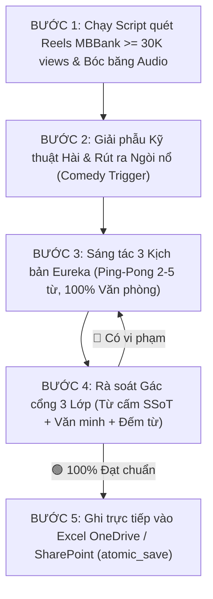

# HƯỚNG DẪN DÀNH CHO AI AGENT: KẾ HOẠCH LẬP KỊCH BẢN VIDEO VIRAL HÀNG NGÀY
## (THAM KHẢO KÊNH MBBANK HẢI DƯƠNG >= 30K VIEWS & CHUYỂN HÓA B2B EUREKA LOGISTICS)

> **TÀI LIỆU QUY TRÌNH CHUẨN (SOP & AGENT DIRECTIVE)**  
> **Áp dụng cho:** Agent 09 (Viral Reels Director), Agent 02 (Policy & SEO Consultant), Agent 08 (Compliance & Fact Checker) thuộc hệ thống PBAN 2.0 của Chị **Nguyễn Thị Ngọc Thúy** (CEO Eureka Logistics).  
> **Mục tiêu:** Mỗi ngày tự động sản xuất **đúng 3 kịch bản video viral mới**, không trùng lặp, mở rộng biên độ tình huống thực tế, tham khảo kho dữ liệu Reels MBBank Hải Dương (ngưỡng $\ge 30,000$ views) được quét bằng script `scripts/scan_mbhaiduong_daily.py`, tuân thủ 100% không từ cấm và xuất bản trực tiếp vào file Excel trên OneDrive / SharePoint.

---

## 📌 I. CÁC NGUYÊN TẮC BẤT BIẾN (CORE DIRECTIVES)

1. **Ngưỡng lọc Video MBBank tham khảo: $\ge 30,000$ views ($\ge$ 3K views)**
   - Tuyệt đối không giới hạn ở mức 30K view làm mất các ý tưởng mới chớm viral. Mọi video Reels của MB Hải Dương có lượt view từ 30K trở lên đều được thu thập và đưa vào kho phân tích.
   - Loại bỏ hoàn toàn các video Livestream dài (> 2 phút) để chỉ tập trung vào Short Video Reels (15s – 60s).

2. **Bóc băng 100% Lời thoại nguyên văn (Full Spoken Dialogue):**
   - Không bao giờ đoán mò ý tưởng qua thumbnail hay vài chữ caption cắt ngắn.
   - Bắt buộc tải luồng audio sạch (`.mp3`) qua `yt-dlp` và dùng AI Speech-to-Text `faster-whisper` để bóc băng nguyên văn từng câu đối đáp, từng vai diễn và các hiệu ứng âm thanh (SFX).

3. **Chỉ tiêu sản xuất & Nguyên tắc Cấm trùng lặp / Tự xóa kịch bản cũ:**
   - **Sản lượng:** Đúng **3 kịch bản mới/ngày** (Đánh mã tiếp nối `EKA-V2-01`, `EKA-V2-02`... `EKA-V2-14`...).
   - **QUY TẮC CẤM TRÙNG LẶP HOẶC TƯƠNG TỰ:** Tuyệt đối không được trùng hoặc tương tự kịch bản cũ (về tình huống drama, ngòi nổ hay cú lật). Mỗi ngày mở rộng sang một ngóc ngách nghiệp vụ thực tế của Eureka (phòng XNK 5 triệu, ứng dụng ERP camera kho Bằng Tường, cấp hạn mức công nợ 10%-40%, gom cont LCL từ 1 khối, giám định máy móc thiết bị cũ theo Quyết định 18, ủy thác C/O Form E...).
   - **CƠ CHẾ TỰ ĐỘNG XÓA KỊCH BẢN ĐÃ SẢN XUẤT:** Nếu kịch bản nào có ghi chú/note **"Đã sản xuất"** (hoặc đã quay xong khi đến lịch) -> **Tự động xóa khỏi danh sách kịch bản chờ quay** trong file Excel để bảng luôn tinh gọn, chỉ chứa các kịch bản sẵn sàng bấm máy.

4. **100% Bối cảnh văn phòng 44 Triều Khúc:**
   - Mọi cảnh quay đều diễn ra trong văn phòng (bàn tiếp khách sofa, quầy lễ tân/chứng từ, bàn làm việc Sếp Thúy, góc máy in, cửa kính). Đạo cụ có sẵn: bút lò xo, thỏi son, tập kẹp file A4, máy in, con dấu.

5. **Quy chuẩn Ngôn từ Văn minh & Tuyệt đối Sạch từ cấm (RULE 20 & SSoT `banned_words.md`):**
   - **Xóa bỏ vĩnh viễn các từ bất lịch sự / chửi bậy:** Không dùng *"Dở à!"*, *"Đếch"*, *"Điên à"*, *"Mày - Tao"* xẵng giọng. Thay bằng phản xạ tưng tửng lịch thiệp của Sếp Thúy: *"Ơ hay!"*, *"Làm ăn thế đấy!"*, *"Chán các bác thế!"*, *"Ai lại thế bao giờ!"*, *"Chịu hai đứa luôn!"*.
   - **Kiểm duyệt từ cấm ngành Logistics:** 100% cấm dùng: `trốn thuế`, `buôn lậu`, `bao thuế`, `tiểu ngạch`, `đồ chơi trẻ em` (không phải thế mạnh của Eureka, Canvas tập trung vào máy móc, thiết bị cơ khí, phụ tùng, linh kiện, gia dụng).

6. **Kỹ thuật Thoại Ping-Pong & Nét mặt Deadpan:**
   - Mỗi câu thoại bắt buộc ngắt từ **2 đến 5 từ**, nói cực nhanh, dồn dập như đánh bóng bàn.
   - Nét mặt đơ toàn tập 1.5s trước khi kết thúc video, tạo tiếng cười châm biếm sâu cay.

---

## 🔄 II. QUY TRÌNH 5 BƯỚC THỰC THI HÀNG NGÀY CỦA AGENT



---

### BƯỚC 1: QUÉT REELS MBBANK & BÓC BĂNG LỜI THOẠI ($\ge 30$K VIEWS)
* **Script thực thi:** [`d:\AI AGENT THUY\AI branding\scripts\scan_mbhaiduong_daily.py`](file:///d:/AI%20AGENT%20THUY/AI%20branding/scripts/scan_mbhaiduong_daily.py)
* **Lệnh kích hoạt tự động qua Terminal:**
  ```powershell
  python "d:\AI AGENT THUY\AI branding\scripts\scan_mbhaiduong_daily.py"
  ```
* **Nhiệm vụ của Agent:**
  1. Đọc dữ liệu đầu ra từ file JSON: [`scratch/mb_daily_inspiration.json`](file:///d:/AI%20AGENT%20THUY/AI%20branding/scratch/mb_daily_inspiration.json).
  2. Kiểm tra bộ lọc `views >= 30000` (đã thu nạp hơn 53+ video chất lượng từ 3.6K đến 3M views).
  3. Với các video mới phát hiện, script tự động tải audio `.mp3` về [`scratch/mb_audio/`](file:///d:/AI%20AGENT%20THUY/AI%20branding/scratch/mb_audio/) và kích hoạt mô hình `faster-whisper` bóc băng toàn bộ lời thoại.

---

### BƯỚC 2: GIẢI PHẪU KỸ THUẬT HÀI MBBANK (REVERSE-ENGINEERING)
Agent không sao chép nguyên xi ngân hàng, mà bóc tách **bản chất cấu trúc gây cười (Comedy Device)**:
1. **Phân tích Cấu trúc 4 nhịp (Chuẩn 30 giây):**
   - *Hook (0-3s):* Đặt kỳ vọng lớn hoặc câu hỏi gây sốc về tiền bạc/dịch vụ VIP.
   - *Escalation (4-15s):* Đối đáp dồn dập, nhả chữ cực nhanh, tung hứng dịch vụ hoàn hảo.
   - *Punchline (16-25s):* Cú lật kèo đâm thủng kỳ vọng ban đầu một cách bất ngờ.
   - *Deflation (26-30s):* Đứng hình đơ mặt 1.5s + Câu chốt hạ văn minh + Sound "Aiyo mama!" hoặc tiếng cười rộ.
2. **Xác định ngòi nổ tâm lý:**
   - Ảo tưởng sức mạnh / Tự tin thái quá (Tài khoản có 50k đòi rút 1 tỷ).
   - Nỗi sợ và tình huống khó đỡ (Sợ vợ mắng, dỗi sếp đòi trả lương đúng thực lực).
   - Hiểu nhầm nghĩa đen (Giữ chân khách hàng $\rightarrow$ ôm chặt bắp chân; 30 củ $\rightarrow$ 30 củ khoai lang).
   - Tự ái vặt vãnh (Bút bi gắn dây lò xo $\rightarrow$ sợ lấy trộm bút).

---

### BƯỚC 3: CHUYỂN HÓA SANG B2B EUREKA LOGISTICS (CREATIVE TRANSFORMATION)
Agent ghép ngòi nổ hài hước vào **Bối cảnh Văn phòng Eureka 44 Triều Khúc** và **Mô hình Canvas**:
1. **Lựa chọn 1 trong 6 Motif luân phiên:**
   - *Motif 1:* Slapstick & Đạo cụ âm thanh / Va chạm vật lý.
   - *Motif 2:* Drama nội bộ công sở (Sếp Thúy vs Nhân viên).
   - *Motif 3:* Trào phúng tâm linh & Thói quen dân buôn xuất nhập khẩu.
   - *Motif 4:* Nỗi sợ vợ thực tế của chủ xưởng kinh doanh.
   - *Motif 5:* Chơi chữ nghĩa đen & Khách vốn nhỏ (Gom cont LCL từ 1 khối).
   - *Motif 6:* Nhại điện ảnh điệp viên & Đấu trí hồ sơ chứng từ.
2. **Lồng ghép Vũ khí nghiệp vụ thật của Eureka:**
   - Gom cont LCL từ 1 khối (1 CBM) xe chạy hàng ngày.
   - Phòng Xuất nhập khẩu thuê ngoài trọn gói chỉ từ 5 triệu/tháng.
   - Đòn bẩy tài chính: Cấp hạn mức công nợ 10% – 40%.
   - 100% Hóa đơn VAT chính ngạch, tư vấn mã HS và C/O Form E miễn phí.
   - Am hiểu >1.000 mặt hàng máy móc, linh kiện, thiết bị, dây chuyền sản xuất (TUYỆT ĐỐI KHÔNG LẤY VÍ DỤ VỀ ĐỒ CHƠI TRẺ EM).
3. **Kỹ thuật viết lời thoại:**
   - Đúng **2 đến 5 từ** mỗi câu thoại (nhịp Ping-Pong).
   - Ngôn từ Sếp Thúy: Đẳng cấp, văn minh, sắc bén, lãnh đạo B2B.

---

### BƯỚC 4: RÀ SOÁT GÁC CỔNG 3 LỚP (ZERO-TRUST COMPLIANCE GATE)
Trước khi xuất bản, Agent tự động chạy quy trình kiểm duyệt:

| Lớp kiểm duyệt | Tiêu chí đánh giá | Hành động bắt buộc nếu vi phạm |
| :--- | :--- | :--- |
| **Lớp 1: SSoT Từ cấm** | Quét file [`knowledge/banned_words.md`](file:///d:/AI%20AGENT%20THUY/AI%20branding/knowledge/banned_words.md). Cấm: `trốn thuế`, `buôn lậu`, `bao thuế`, `tiểu ngạch`, `đồ chơi`. | Thay thế bằng: `tối ưu thuế hợp pháp`, `chính ngạch an toàn`, `thiếu hóa đơn`, mặt hàng `máy móc, linh kiện`. |
| **Lớp 2: Văn minh & Tôn trọng** | Cấm từ chửi bậy, chợ búa, xẵng giọng: `dở à`, `đếch`, `điên à`, `mày - tao` ác ý. | Thay bằng: `Ơ hay!`, `Làm ăn thế đấy!`, `Chán các bác thế!`, `Ai lại thế bao giờ!`, `Chịu anh luôn!`. |
| **Lớp 3: Đo đếm cấu trúc** | Đếm số từ từng câu (2-5 từ). Kiểm tra đủ 4 nhịp kịch bản và thời lượng 15s-45s. | Viết lại câu thoại dài thành 2-3 câu ngắn dồn dập. |

---

### BƯỚC 5: XUẤT BẢN VÀ ĐỒNG BỘ ĐÚNG 2 FILE EXCEL TRÊN ONEDRIVE
Agent cập nhật kết quả vào đúng 2 file mục tiêu độc lập trên OneDrive (theo phân công của Chị Thúy):

1. **File 1 (ĐÀO KỊCH BẢN CỦA MB):**
   - Đường dẫn OneDrive: `C:\Users\thuyn\OneDrive - EUREKA TRADE AND IMPORT EXPORT COMPANY LIMITED\BRANDING\video content\BANG_KICH_BAN_EUREKA_CHUAN_THOAI_MB.xlsx.tmp.xlsx` *(hoặc `.xlsx`)*
   - Link SharePoint: `https://erktransport-my.sharepoint.com/personal/thuyn_erktransport_com/Documents/BRANDING/video%20content/BANG_KICH_BAN_EUREKA_CHUAN_THOAI_MB.xlsx?web=1`
   - Nội dung: Lưu trữ toàn bộ dữ liệu đào & bóc băng thoại gốc MBBank (>= 30K views) đối ứng kịch bản văn phòng Eureka 1:1.

2. **File 2 (TẠO KỊCH BẢN MỚI CỦA EUREKA):**
   - Đường dẫn OneDrive: `C:\Users\thuyn\OneDrive - EUREKA TRADE AND IMPORT EXPORT COMPANY LIMITED\BRANDING\video content\BANG_10_KICH_BAN_VIRAL_EUREKA_DA_DANG_6_MOTIF.xlsx`
   - Nội dung: Cập nhật 3 kịch bản mới mỗi ngày vào Sheet 1 (`KICH_BAN_VIRAL_REELS`); tự động xóa kịch bản note "Đã sản xuất" khi đến lịch; cập nhật ý tưởng tham khảo vào Sheet 4.

3. **Báo cáo Đồng Bộ vào Bảng Chỉ Dẫn Desktop:**
   - Ngay sau khi hoàn thành ghi file Excel, Agent bắt buộc kích hoạt:
     `python "D:\AI AGENT THUY\QUAN_TRI_TASK_HANG_NGAY\generator_chi_dan.py"`
   - Đích đến hiển thị: `C:\Users\thuyn\Desktop\TONG_HOP_CHI_DAN_TASK_VA_FILE_KET_QUA_HANG_NGAY.xlsx` (Sheet 01 mục 12 & 13) và `C:\Users\thuyn\Desktop\BANG_CHIDAN_TASK_VA_KETQUA_HANGNGAY.html` để Sếp theo dõi tiến độ một chạm.

> [!IMPORTANT]
> **Kỹ thuật lưu nguyên tử (RULE 10 - Atomic Save):**
> Luôn ghi workbook ra file đệm `.tmp.xlsx` sau đó dùng lệnh đổi tên `os.replace` để tránh xung đột sync OneDrive và không bao giờ để lại file backup rác. Nếu phát hiện file đang bị mở trong Excel (PermissionError), lưu vào bản đệm chờ sẵn và thông báo để người dùng đóng Excel là tự động hoàn tất.

---

## 📋 III. MẪU KỊCH BẢN CHUẨN 9 CỘT HÀNG NGÀY

Khi Agent xuất bản 3 kịch bản mới mỗi ngày, phải đảm bảo cấu trúc chuẩn:

```text
Cột 1: STT (1, 2, 3...)
Cột 2: Mã KB (EKA-V2-14, EKA-V2-15...)
Cột 3: Motif thể loại (1 trong 6 motif)
Cột 4: Tiêu đề Video (Caption Hook & Lượt View tham khảo)
Cột 5: Thế mạnh Eureka lồng ghép (Canvas Asset)
Cột 6: Phân vai diễn xuất & Đạo cụ văn phòng
Cột 7: Kịch bản thoại Ping-Pong (2-5 từ/câu, đối thoại dồn dập, Deadpan)
Cột 8: Cú lật hài hước (Punchline)
Cột 9: Thời lượng (giây: 18s - 35s)
```

### Ví dụ Kịch bản Mẫu đạt chuẩn 100%:
* **Mã KB:** `EKA-V2-14`
* **Motif:** Drama nội bộ Sếp vs Nhân viên (Motif 2)
* **Tiêu đề:** *"Tra cứu tồn kho kiểu này thì Sếp chịu rồi! (Tham khảo Reel 34K views)"*
* **Thế mạnh:** Ứng dụng Portal ERP kiểm tra vị trí hàng hóa tại kho Bằng Tường bằng camera thời gian thực 24/7.
* **Phân vai:** Sếp Thúy ngồi trước máy tính + 1 Nhân viên Sales Gen Z cầm điện thoại.
* **Kịch bản thoại Ping-Pong:**
  > • **Sếp Thúy:** Lô máy bơm nước?  
  > • **Sales:** Về kho Bằng Tường rồi!  
  > • **Sếp Thúy:** Kiểm tra hàng chưa?  
  > • **Sales:** Kiểm tra qua camera app!  
  > • **Sếp Thúy:** Thấy hàng nguyên vẹn không?  
  > • **Sales:** Thấy rõ từng góc cạnh!  
  > • **Sếp Thúy:** Đâu, mở app chị xem?  
  > • **Sales (chìa điện thoại):** Đây, đang trực tiếp luôn!  
  > • **Sếp Thúy (nhìn màn hình, đơ mặt 1.5s):** Ơ hay! Đây là camera chuồng gà nhà bác bảo vệ mà?!  
  > • **Sales (tỉnh bơ):** Thì gà cũng nguyên vẹn mà Sếp!  
  > • *(Sound: Aiyo mama! Cả phòng đứng hình)*
* **Cú lật:** Tự tin khoe giám sát kho quốc tế qua camera app, hóa ra bấm nhầm camera chuồng gà quê bác bảo vệ.
* **Thời lượng:** 22s.

---

## ✅ IV. BẢNG CHECKLIST ĐÁNH GIÁ KỊCH BẢN TRƯỚC KHI BẤM MÁY

Trước khi bàn giao kịch bản cho Chị Thúy và Ekip 44 Triều Khúc, Agent phải tích đủ **8 tiêu chí xanh**:

- [ ] 1. Video tham khảo từ kênh MB Hải Dương có lượt view $\ge 30,000$ (hoặc bóc băng từ kho $\ge 30$K).
- [ ] 2. Đã bóc băng nguyên văn lời thoại âm thanh thật, không đoán mò thumbnail.
- [ ] 3. Đạt đúng chỉ tiêu 3 kịch bản mới/ngày, không trùng lặp các kịch bản trước.
- [ ] 4. Bối cảnh 100% trong văn phòng Eureka, đạo cụ tối giản có sẵn.
- [ ] 5. Nhịp thoại bóng bàn Ping-Pong: 100% các câu thoại từ 2 đến 5 từ.
- [ ] 6. Diễn xuất Deadpan mặt lạnh tỉnh bơ, không diễn hài nhảm/lố lăng.
- [ ] 7. Quét sạch 100% từ cấm trong `knowledge/banned_words.md` và không có từ chửi bậy (dở à, đếch).
- [ ] 8. Đồng bộ an toàn (atomic_save) vào đúng file Excel trên OneDrive / SharePoint.
- [ ] 9. Đã kích hoạt generator_chi_dan.py để cập nhật báo cáo vào Desktop TONG_HOP_CHI_DAN_TASK_VA_FILE_KET_QUA_HANG_NGAY.xlsx.
