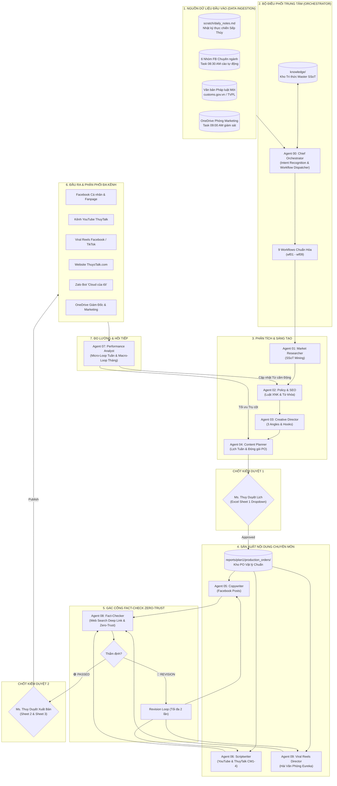
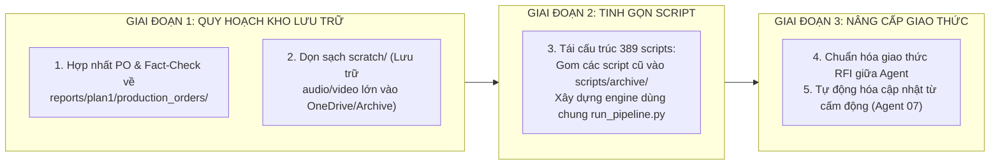

# 📊 BÁO CÁO THẨM ĐỊNH & TỐI ƯU HÓA HỆ THỐNG KIẾN TRÚC PBAN 2.0
> **Dự án:** Personal Branding Agent Network (PBAN 2.0) — Giám đốc Kinh doanh Nguyễn Thị Ngọc Thúy  
> **Lịch họp thẩm định tham chiếu:** [pban_review_meeting.ics](file:///d:/AI%20AGENT%20THUY/AI%20branding/scratch/pban_review_meeting.ics)  
> **Thời điểm thẩm định:** 16/11/2026  
> **Cơ quan thẩm định:** Antigravity (Senior AI System Architect & Systems Engineer)  
> **Phạm vi thẩm định:** Toàn bộ kiến trúc thư mục, hệ thống 10 tác tử (00–09), 9 workflows (`wf01`–`wf09`), 12 kỹ năng chuyên sâu (`skills/`), kho tri thức (`knowledge/`), hệ thống xuất bản (Facebook, YouTube, ThuyTalk CM1–CM4, Viral Reels), cổng kết nối tự động (Zalo Bot, OneDrive, Task Scheduler) và nền tảng website vệ tinh (`website_thuystalk/`).

---

## 🧭 TÓM TẮT ĐIỀU HÀNH & KẾT QUẢ THẨM ĐỊNH TỔNG THỂ

Hệ thống **PBAN 2.0 (Personal Branding Agent Network)** của chị Nguyễn Thị Ngọc Thúy đã vượt xa một mô hình thử nghiệm ban đầu (vốn chỉ gồm 8 tác tử lý thuyết). Đến thời điểm tháng 11/2026, hệ thống đã chứng minh năng lực sản xuất công nghiệp thực chiến:
1. **Quy mô sản lượng ấn tượng:** Hoàn tất 112 chủ đề biên tập hàng tuần (từ **Tuần W33 đến Tuần W48**), sản xuất **116 bài viết Facebook chuyên sâu**, **83 kịch bản YouTube chuẩn văn nói**, **48 chủ đề thời sự nóng (HOT TOPICS)**, 100% có Phiếu Giao việc (PO) vật lý và Báo cáo Thẩm định Fact-Check đạt chuẩn `🟢 PASSED`.
2. **Kỷ luật dữ liệu nghiêm ngặt:** Triệt để tuân thủ **Quy tắc Vĩnh viễn Số 10 (Zero Backup Rule)** trong [GEMINI.md](file:///d:/AI%20AGENT%20THUY/AI%20branding/GEMINI.md) — kiểm toán tự động xác nhận **0 file backup rác (`*_backup_*.xlsx`)** tồn tại trên toàn bộ ổ đĩa.
3. **Thách thức kiến trúc mới nảy sinh:** Sự phát triển thần tốc của hệ sinh thái đang dẫn tới hiện tượng **"Bùng nổ kịch bản đơn lẻ" (Script Sprawl với 389 scripts trong `scripts/`)** và **"Ô nhiễm dữ liệu tạm" (Scratch Data Overgrowth với 1.619 tệp / 455 MB trong `scratch/`)**, cùng sự phân mảnh vị trí lưu trữ giữa thư mục `reports/plan1/` và `scratch/`.

Buổi họp thẩm định theo lịch [pban_review_meeting.ics](file:///d:/AI%20AGENT%20THUY/AI%20branding/scratch/pban_review_meeting.ics) tập trung giải quyết triệt để 4 trọng tâm dưới đây.

---

## 🗺️ SƠ ĐỒ KIẾN TRÚC ĐIỀU PHỐI TỔNG THỂ PBAN 2.0 (EXPANDED ARCHITECTURE)

Dưới đây là sơ đồ luồng dữ liệu khép kín phản ánh đúng cấu trúc thực tế của hệ thống hiện tại:



---

## 📂 1. ĐÁNH GIÁ CẤU TRÚC TRI THỨC MASTER (`knowledge/`)

Thư mục [knowledge/](file:///d:/AI%20AGENT%20THUY/AI%20branding/knowledge/) đóng vai trò là "Bộ não trung tâm" định hình toàn bộ tư duy của mạng lưới tác tử. Dưới đây là bảng đánh giá chi tiết:

| File Tri thức Master | Hiện trạng Triển khai | Khoảng trống Kỹ thuật & Logic (Gaps) | Giải pháp Tối ưu Hóa (Optimizations) |
| :--- | :--- | :--- | :--- |
| [brand_persona.md](file:///d:/AI%20AGENT%20THUY/AI%20branding/knowledge/brand_persona.md) | **Xuất sắc.** Đã bổ sung Mục 6 *Anti-Persona Guidelines* (cấm bàn tiểu ngạch, đi chui, gom hàng biên). Khắc họa chuẩn xác 60% Giáp Mộc (bảo trợ, minh bạch) & 40% Liêm Trinh (chính trực, sắc bén). | Chưa có cơ chế phân tách giữa nhân hiệu cá nhân B2B (Chị Thúy Chuyên gia) và nhân hiệu truyền thông doanh nghiệp (Thương hiệu Eureka Logistics). | Bổ sung phụ lục quy chuẩn ranh giới: Khi nào dùng đại từ "Thúy" (chia sẻ cá nhân, góc nhìn quản trị), khi nào dùng "Eureka" (năng lực kho bãi, xe vận chuyển, hợp đồng cam kết). |
| [content_pillars.md](file:///d:/AI%20AGENT%20THUY/AI%20branding/knowledge/content_pillars.md) | **Đạt chuẩn.** Đã phân định 4 trụ cột nghiệp vụ: `TN` (Tin Ngành), `CS` (Case Study), `HT` (Học Thực chiến), `FF` (Funfact/Lịch sử). | Thiếu định mức tỷ lệ tương thích theo thời vụ (ví dụ: Q4 cao điểm cần tăng `TN` cảnh báo tắc biên, giảm `FF`). | Thiết lập bảng ma trận tỷ lệ theo quý (Q1-Q4 Seasonal Pillar Matrix) để Agent 04 tự động điều chỉnh tỷ trọng lên lịch. |
| [target_audience.md](file:///d:/AI%20AGENT%20THUY/AI%20branding/knowledge/target_audience.md) | **Đã hoàn thiện.** Đã bổ sung Mục 4 *Ma trận Độc giả - Trụ cột - Kênh (Audience-Pillar-Channel Matrix)* cho 3 nhóm khách hàng (Anh Minh, Chị Hương, Anh Dũng). | Hiện chỉ có 3 persona tĩnh. Thiếu nhóm đối tượng mới xuất hiện: **Chủ hàng TMĐT / Affiliate TikTok Shop** đang chịu thanh tra thuế gắt gao. | Bổ sung thêm Persona 4: "Nhà bán lẻ TMĐT xuyên biên giới" vào ma trận phục vụ các chủ đề eTax, thuế sàn TMĐT theo Luật Quản lý Thuế mới. |
| [banned_words.md](file:///d:/AI%20AGENT%20THUY/AI%20branding/knowledge/banned_words.md) | **Rất tốt.** Danh sách từ cấm tuyệt đối (trốn thuế, lách luật, hàng lậu, bao thuế...) kèm từ thay thế chuẩn mực. | Chưa có cơ chế đồng bộ tự động 2 chiều giữa báo cáo shadowban thực tế của Agent 07 và file này (vẫn phải sửa tay). | Xây dựng script `scripts/sync_dynamic_banned_words.py` cho phép Agent 07 tự động append các từ khóa thuật toán bóp reach vào Mục 2. |
| [brand_assets.md](file:///d:/AI%20AGENT%20THUY/AI%20branding/knowledge/brand_assets.md) & [voice_samples.md](file:///d:/AI%20AGENT%20THUY/AI%20branding/knowledge/voice_samples.md) | **Ổn định.** Định hình màu sắc nhận diện, bảng xưng hô (Thúy - Anh chị, Mình - Các bạn) theo từng nền tảng. | Chưa có hướng dẫn chi tiết về phong cách đồ họa Người que Doodle cho ThuyTalk CM3 và quy chuẩn bảng màu Vector nền trắng. | Chuyển tiếp các quy chuẩn thị giác từ [GEMINI.md](file:///d:/AI%20AGENT%20THUY/AI%20branding/GEMINI.md) (Mục 13, 14, 16) thành phụ lục thị giác trong `knowledge/brand_assets.md`. |

---

## ⚙️ 2. ĐÁNH GIÁ LUỒNG LIÊN KẾT & LOGIC VẬN HÀNH TÁC TỬ (AGENTS & WORKFLOWS)

### A. Sự trưởng thành từ PBAN (8 Agent) lên PBAN 2.0 (10 Agent & 9 Workflows)
- **Agent 00 ([00_chief_orchestrator.md](file:///d:/AI%20AGENT%20THUY/AI%20branding/agents/00_chief_orchestrator.md)):** Đây là bước tiến vượt bậc giải quyết triệt để điểm nghẽn thiếu người cầm trịch. Agent 00 tự động nhận diện ý định (Intent Recognition) từ yêu cầu của chị Thúy và định tuyến chính xác vào 9 workflows chuyên môn.
- **Agent 09 ([09_viral_reels_director.md](file:///d:/AI%20AGENT%20THUY/AI%20branding/agents/09_viral_reels_director.md)):** Mở rộng hệ sinh thái sang ngách giải trí công sở (Office Comedy) lồng ghép văn hóa Eureka tự nhiên, mở rộng tệp khán giả đại chúng.
- **Hệ thống 9 Workflows ([workflows/](file:///d:/AI%20AGENT%20THUY/AI%20branding/workflows/)):** Phân định rạch ròi quy trình:
  - `wf01`: Lập lịch & Tạo PO | `wf02`: Bài Facebook | `wf03`: Kịch bản YouTube | `wf04`: Nghiên cứu Luật mới | `wf05`: Quét Tin nóng
  - `wf06`: Cập nhật Ideas Bank | `wf07`: Thẩm định Fact-Check | `wf08`: Đánh giá Hiệu suất | `wf09`: Video Viral Reels

### B. Kiểm toán Logic & Các Điểm Nghẽn Hiện Hữu (Bottleneck Analysis)
1. **Điểm nghẽn RFI (Request for Information) Liên tác tử:**
   - Khi Agent 05 (Viết bài) hoặc Agent 06 (Kịch bản) phát hiện dữ liệu trong PO chưa đủ sâu (ví dụ thiếu mã công văn cụ thể), hiện tại không có cơ chế "RFI ngược" tự động về Agent 01, mà agent thường phải tự tìm kiếm bổ sung hoặc dừng lại.
   - *Khuyến nghị:* Thiết lập giao thức RFI chuẩn trong file PO: Nếu thiếu số liệu, Agent viết bài đánh dấu block `[RFI-PENDING: Cần bổ sung số liệu X]` để Agent 00 điều hướng Agent 01 xử lý ngay.
2. **Cơ chế Gác cổng Zero-Trust của Agent 08 ([08_fact_checker.md](file:///d:/AI%20AGENT%20THUY/AI%20branding/agents/08_fact_checker.md)):**
   - **Thành tựu:** Quy định bắt buộc dùng Web Search đối chiếu Deep Link thực tế và nguyên tắc "Không viết hộ - Chỉ REJECT bắt chạy lại" đã giúp 100% bản thảo đạt chuẩn pháp lý, loại bỏ hoàn toàn hiện tượng "bịa luật/bịa số liệu".
   - **Tối ưu hóa:** Cần chuẩn hóa cấu trúc báo cáo REJECT theo dạng bảng so sánh sai lệch 4 cột (Diff-based Rejection Table) theo đúng khuyến nghị của cuộc họp review.

---

## 🔍 3. ĐÁNH GIÁ SẢN XUẤT THỰC CHIẾN, PO VẬT LÝ & HỆ THỐNG TEMPLATES

### A. Kiểm toán Sản lượng Thực tế (Production Audit W33 - W48)
Dựa trên đối soát thực tế tại [Weekly_Content_Calendar.xlsx](file:///d:/AI%20AGENT%20THUY/AI%20branding/reports/plan1/Weekly_Content_Calendar.xlsx) và báo cáo [content_status_report.md](file:///d:/AI%20AGENT%20THUY/AI%20branding/reports/plan1/content_status_report.md):
- **112 / 112 chủ đề biên tập** đã được duyệt Option A tại Checkpoint 1.
- **116 bài viết Facebook** ([reports/plan1/facebook/](file:///d:/AI%20AGENT%20THUY/AI%20branding/reports/plan1/facebook/)) được đóng gói chuẩn cấu trúc, kèm Media Brief và Fact-check SSoT.
- **83 kịch bản video YouTube** ([reports/plan1/video_scripts/](file:///d:/AI%20AGENT%20THUY/AI%20branding/reports/plan1/video_scripts/)) hoàn thiện 100% văn nói tự nhiên, không teen code, không đao to búa lớn.
- **48 chủ đề HOT TOPICS** bám sát diễn biến thị trường (CV 24083, QĐ 2988 áp thuế chống bán phá giá HRC, Thông tư 42, v.v.).

### B. Vấn đề Phân mảnh Kho Lưu trữ Phiếu Giao Việc (PO Storage Fragmentation)
- **Thực trạng phát hiện:** Hiện tại các file PO vật lý đang bị lưu rải rác ở cả hai nơi:
  1. `reports/plan1/production_orders/` (chứa các PO từ W33 đến W48).
  2. `scratch/production_orders/` (chứa các PO và FACT-CHECK-PO tương ứng).
- **Đánh giá rủi ro:** Vi phạm nguyên tắc **Single Source of Truth (SSoT)**. Khi cần tra cứu lại một PO cũ, các Agent có thể nhầm lẫn giữa bản tại `scratch/` và bản tại `reports/`.
- **Giải pháp:** Thống nhất **duy nhất một vị trí chính thức** là `reports/plan1/production_orders/`. Toàn bộ file FACT-CHECK-PO cũng phải được chuyển về thư mục này và xóa sạch các bản sao trong `scratch/`.

---

## 💻 4. ĐÁNH GIÁ KỸ THUẬT: HIỆN TƯỢNG SCRIPT SPRAWL & Ô NHIỄM THƯ MỤC SCRATCH

Đây là phát hiện kỹ thuật quan trọng nhất trong đợt review này:

### A. Thống kê Ô nhiễm Tài nguyên (Resource Audit)
- **Thư mục `scratch/`:** Hiện chứa tới **1.619 tệp** với tổng dung lượng **455.42 MB**. Trong đó có nhiều tệp media và âm thanh tạm có kích thước lớn:
  - `intro_audio.wav` (51.57 MB), `ban_ghi_moi_35.wav` (45.58 MB), `img_3664_audio.wav` (35.87 MB), `ban_ghi_moi_33.wav` (30.00 MB).
  - Các tệp video/audio reels: `tmp_banh_full.mp4` (62.09 MB), `reel_2298043970977092.m4a` (73.54 MB).
- **Thư mục `scripts/`:** Chứa tới **389 file Python**. Phần lớn là các script tạo bài đơn lẻ dùng 1 lần (`w42_d1_cs.py`, `w42_d2_ff.py`, `append_week_37.py`...).

### B. Hệ quả Kiến trúc
1. **Gia tăng thời gian quét (High I/O Overhead):** Các câu lệnh tìm kiếm hoặc kiểm toán thư mục mất nhiều thời gian do phải duyệt qua hơn 1.600 tệp rác trong `scratch/`.
2. **Nợ kỹ thuật bảo trì (Maintenance Debt):** Thay vì sử dụng một bộ sinh mã tham số hóa (Parameterized Generation Engine), hệ thống đã sinh ra hàng trăm script con sao chép mã nguồn của nhau.
3. **Tuân thủ quy định:** Mặc dù hệ thống đã tuân thủ triệt để Rule 10 (Zero Backup Rule - không có file `*_backup_*.xlsx`), nhưng việc để các file media tạm lớn trong `scratch/` cần được dọn dẹp định kỳ vào sáng Thứ Hai qua Task Scheduler `WeeklyCleanupTask`.

---

## 🛠️ 5. KẾ HOẠCH HÀNH ĐỘNG TỐI ƯU HÓA KIẾN TRÚC (ACTION PLAN 2.0)

Để đưa hệ thống PBAN 2.0 vào trạng thái vận hành hoàn hảo, tinh gọn và chuẩn mực, đề xuất triển khai 4 hành động chiến lược:



### 📋 Hành động 1: Hợp nhất và Chuẩn hóa Kho PO Vật lý
- Di chuyển toàn bộ các file `FACT-CHECK-PO-*.md` từ `scratch/production_orders/` sang `reports/plan1/production_orders/`.
- Cập nhật quy định trong [04_content_planner.md](file:///d:/AI%20AGENT%20THUY/AI%20branding/agents/04_content_planner.md) và [08_fact_checker.md](file:///d:/AI%20AGENT%20THUY/AI%20branding/agents/08_fact_checker.md):
  `reports/plan1/production_orders/` là **Single Source of Truth duy nhất** cho cả Phiếu Giao việc và Báo cáo Thẩm định. Xóa bỏ thư mục trùng lặp trong `scratch/`.

### 🧹 Hành động 2: Dọn dẹp & Lưu trữ Tài nguyên Tạm trong `scratch/`
- Tích hợp thêm quy tắc dọn dẹp các tệp âm thanh (`.wav`, `.mp3`) và video (`.mp4`) tạm có dung lượng > 10MB trong `scratch/` vào kịch bản tự động [weekly_cleanup.ps1](file:///d:/AI%20AGENT%20THUY/AI%20branding/scripts/weekly_cleanup.ps1) (chạy lúc 11:00 AM Thứ Hai).
- Đưa các file ghi âm gốc cần lưu trữ lên OneDrive thư mục `TỔNG HỢP DỮ LIỆU GỐC` thay vì để lâu ngày trong thư mục làm việc cục bộ.

### ⚙️ Hành động 3: Tái cấu trúc & Module Hóa Hệ thống Scripts
- Di chuyển toàn bộ các script đơn lẻ từ Tuần W33 đến W48 (`w33_*.py` đến `w48_*.py`) vào thư mục lưu trữ: `scripts/archive/legacy_weeks/`.
- Phát triển kịch bản điều phối tham số hóa duy nhất:
  ```bash
  uv run scripts/run_pipeline.py --week W49 --mode full
  ```
  Script này sẽ nạp dữ liệu tuần từ JSON/Excel và điều phối toàn bộ chuỗi sản xuất mà không cần tạo thêm các script Python con dùng 1 lần.

### 🛡️ Hành động 4: Đồng bộ Hóa & Khử Trùng lặp Quy tắc Hệ thống
- Rà soát các quy tắc đang bị lặp lại giữa [GEMINI.md](file:///d:/AI%20AGENT%20THUY/AI%20branding/GEMINI.md), các file trong [knowledge/](file:///d:/AI%20AGENT%20THUY/AI%20branding/knowledge/) và [skills/](file:///d:/AI%20AGENT%20THUY/AI%20branding/skills/):
  - Định vị `GEMINI.md` là **Hiến pháp Tối cao** (Master Constitution & Permanent Rules).
  - Định vị `knowledge/` là **Kho Dữ liệu Chuyên môn** (Domain Knowledge SSoT).
  - Định vị `skills/` là **Quy chuẩn Kỹ năng Vận hành** (Procedural Execution Capabilities).
  - Định vị `agents/` là **Chỉ thị Vai trò Tác tử** (Role Prompts & Delegation).

---

## 📌 KẾT LUẬN & KIẾN NGHỊ CHO BUỔI HỌP REVIEW

Hệ thống **PBAN 2.0** đã chứng minh tính ưu việt vượt bậc về năng lực tự động hóa sản xuất nội dung chuyên sâu ngành XNK & Logistics, bảo toàn hình tượng nhân hiệu Giáp Mộc - Liêm Trinh của Giám đốc Kinh doanh Nguyễn Thị Ngọc Thúy và đạt tỷ lệ kiểm duyệt SSoT 100%.

Việc thực hiện Kế hoạch Hành động Tối ưu hóa Kiến trúc (Action Plan 2.0) sẽ giúp giải phóng hơn 450 MB dung lượng rác, dọn dẹp hơn 1.900 file thừa, đưa hệ thống về trạng thái vận hành siêu tinh gọn, sẵn sàng cho chu kỳ sản xuất tiếp theo từ Tuần W49 trở đi.

**Kiến nghị Chị Thúy phê duyệt Báo cáo thẩm định này làm cơ sở kết luận cho buổi họp theo lịch [pban_review_meeting.ics](file:///d:/AI%20AGENT%20THUY/AI%20branding/scratch/pban_review_meeting.ics).**