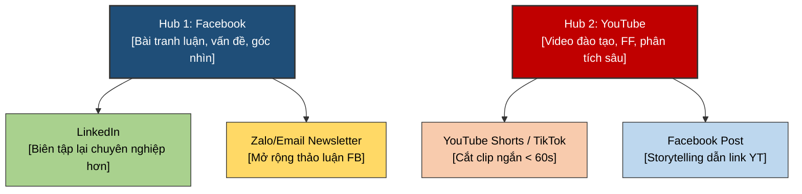

# 🔄 HƯỚNG DẪN TÁI SỬ DỤNG & PHÂN RÃ NỘI DUNG (CONTENT REPURPOSING GUIDE)
*Tài liệu này định hướng cho các Agent (03, 04, 05, 06) cách chuyển đổi một nội dung gốc chất lượng cao (Hub Content - ví dụ một bài phân tích chuyên sâu trên LinkedIn) thành nhiều nội dung vệ tinh (Spoke Content) phù hợp với định dạng và độc giả của các nền tảng khác nhau.*

---

## 🧭 Mô hình Phân rã Nội dung (Hub-and-Spoke Model)

---

## 🛠️ Quy trình 3 Bước Phân rã Nội dung thực chiến

### Bước 1: Xác định hạt nhân tri thức (Core Asset)
- Trích xuất dữ liệu gốc (SSoT), điều luật hải quan chính xác, công thức tính toán, hoặc cốt truyện câu chuyện thực tế từ bài viết gốc.
- Tuyệt đối loại bỏ các từ nối, cấu trúc trình bày cũ. Chỉ giữ lại phần lõi thông tin.

### Bước 2: Dịch chuyển văn phong theo Nền tảng (Sử dụng Persona để hiểu ngầm)
- Đối chiếu với chân dung độc giả của kênh đích tại [target_audience.md](file:///d:/AI%20AGENT%20THUY/AI%20branding/knowledge/target_audience.md):
  - Chuyển từ **Facebook sang LinkedIn**: Thay đổi cấu trúc tranh luận thành bài học chuyên môn (bullet points), giữ tone chuyên nghiệp hơn cho B2B.
  - Chuyển từ **YouTube sang Shorts/TikTok**: Viết kịch bản cắt ghép nhanh, gãy gọn, nhấn mạnh hook 3s đầu tiên.
  - Chuyển từ **YouTube sang Facebook**: Biến một ý trong video thành câu hỏi tranh luận, dẫn link YouTube.

### Bước 3: Đóng gói theo Template Nền tảng
- Soạn thảo nội dung tuân thủ đúng giới hạn độ dài và định dạng của các file template tương ứng.

---

## 📊 Ma trận Chuyển đổi định dạng mẫu (Repurposing Matrix)

| Từ Nguồn (Hub) | Sang Kênh Đích (Spoke) | Cách chuyển đổi cụ thể |
| :--- | :--- | :--- |
| **Bài tranh luận Facebook** (Góc nhìn mở) | ➡️ **Bài đăng LinkedIn** | Trích xuất các ý kiến từ comment thành luận điểm chuyên môn. Cấu trúc lại bằng bullet points và tiêu đề phụ. |
| **Video phân tích YouTube** (10 phút) | ➡️ **YouTube Shorts** | Cắt đoạn chia sẻ 1 sự thật bất ngờ (Funfact) hoặc 1 bước quan trọng dưới 60s làm Highlight. |
| **Video dài YouTube** (Học 5 phút) | ➡️ **Facebook Post** | Lấy 1 rủi ro/lỗi sai trong video làm thành bài post đặt vấn đề trên Facebook, kêu gọi xem YouTube để biết cách sửa. |

---

## 🚫 Các quy tắc Anti-Pattern trong Tái sử dụng nội dung
- ❌ **Cấm sao chép nguyên văn (No Copy-Paste):** Không bao giờ đăng tải cùng một nội dung chữ giống hệt nhau lên cả Facebook và LinkedIn. Độc giả theo dõi song song sẽ thấy sự thiếu chỉn chu và nhàm chán.
- ❌ **Tránh đăng đồng thời (Scheduling Spacing):** Không phát hành các định dạng tái sử dụng của cùng một chủ đề trên cùng một nền tảng trong cùng một ngày. Hãy giãn cách thời gian đăng từ 3-7 ngày để tối ưu tần suất tiếp cận độc giả.
- ❌ **Không bê nguyên thuật ngữ sang TikTok/Facebook:** Tuyệt đối không giữ các thuật ngữ công nghệ/logistics quá phức tạp khi chuyển kênh từ LinkedIn sang Facebook/TikTok mà không giải thích đơn giản hóa.
