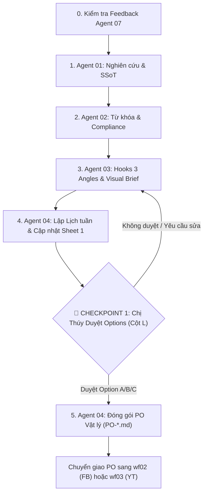

# WORKFLOW 01: LẬP LỊCH NỘI DUNG TUẦN (WEEKLY CONTENT PLANNING)

*Mã quy trình:* `wf01`  
*Mục tiêu:* Tiếp nhận chủ đề hoặc nhật ký tuần để nghiên cứu, phân tích SEO, sáng tạo góc tiếp cận, lập Lịch tuần 3 phương án (Options A/B/C) và đóng gói các Phiếu Giao việc (PO) vật lý sau khi chị Thúy duyệt.  
*Tác tử tham gia:* **Agent 01 (Research)**, **Agent 02 (SEO)**, **Agent 03 (Creative)**, **Agent 04 (Planner)**, **Agent 07 (Performance - nếu có feedback)**.

---

## 🧭 1. Điều kiện Kích hoạt & Đầu vào (Trigger & Inputs)

- **Câu lệnh kích hoạt mẫu:** *"Lên lịch nội dung tuần 34", "Lập content calendar cho tuần mới", "Lên kế hoạch bài đăng tuần"*
- **Dữ liệu đầu vào:**
  1. [`knowledge/content_pillars.md`](file:///d:/AI%20AGENT%20THUY/AI%20branding/knowledge/content_pillars.md) — 4 Trụ cột nội dung (CS, TN, HT, FF).
  2. [`scratch/daily_notes.md`](file:///d:/AI%20AGENT%20THUY/AI%20branding/scratch/daily_notes.md) — Nhật ký sự kiện, trải nghiệm thực tế gần nhất của chị Thúy.
  3. [`reports/Danh_sach_Van_ban_Phap_luat_XNK.xlsx`](file:///d:/AI%20AGENT%20THUY/AI%20branding/reports/Danh_sach_Van_ban_Phap_luat_XNK.xlsx) — Danh mục văn bản luật đã xác minh.
  4. [`reports/SEO_Keyword_Trends_Eureka.xlsx`](file:///d:/AI%20AGENT%20THUY/AI%20branding/reports/SEO_Keyword_Trends_Eureka.xlsx) — Từ khóa SEO ngành & tin nóng.
  5. Báo cáo Feedback từ `Agent 07` (nếu có từ chu kỳ trước).

---

## 🔄 2. Các Bước Phối Hợp Tuần Tự (Step-by-Step Execution)



### Bước 0: Kiểm tra Feedback Tối ưu hóa (Agent 07)
- **Hành động:** Kiểm tra xem có khuyến nghị về khung giờ đăng, định dạng hiệu quả cao hay danh sách từ cấm động mới từ `Agent 07` không để đưa vào yêu cầu lập lịch.

### Bước 1: Nghiên cứu chuyên sâu & Thiết lập SSoT (Agent 01)
- **Đầu vào:** Ý tưởng chọn lọc từ kho Pillars hoặc `scratch/daily_notes.md`.
- **Hành động:** Quét dữ liệu web search theo quy trình `ssot-research`, tìm số hiệu văn bản pháp luật, mã HS, dẫn chứng quốc tế hoặc câu chuyện lịch sử.
- **Đầu ra:** Báo cáo Nghiên cứu Cơ hội Nội dung & SSoT.

### Bước 2: Phân bổ Từ khóa & Compliance Check (Agent 02)
- **Đầu vào:** Báo cáo SSoT từ Bước 1.
- **Hành động:** Đối chiếu `SEO_Keyword_Trends_Eureka.xlsx` để chọn từ khóa chính, từ khóa phụ; lọc từ cấm từ `knowledge/banned_words.md` và kiểm tra compliance.
- **Đầu ra:** SEO & Compliance Brief.

### Bước 3: Sáng tạo Góc Tiếp Cận & Hooks (Agent 03)
- **Đầu vào:** Đầu ra Bước 1 & Bước 2.
- **Hành động:** Xây dựng 3 phương án Angles (A: Kích thích tư duy, B: Trao giá trị thực chiến, C: Kể chuyện), viết Hooks và định hướng Visual Concept.
- **Đầu ra:** Concept Angles & Hooks.

### Bước 4: Lập Lịch Tuần & Điền Sheet 1 (Agent 04)
- **Đầu vào:** Tổng hợp dữ liệu từ Bước 1, 2, 3.
- **Hành động:**
  - Cân đối tỷ lệ 60% Giáp Mộc & 40% Liêm Trinh, tỷ lệ nền tảng (Facebook 4-5 bài/tuần, YouTube 1-2 video/tuần).
  - Điền đầy đủ dữ liệu 3 phương án vào **Sheet 1 (Weekly Calendar)** của tệp [`Weekly_Content_Calendar.xlsx`](file:///d:/AI%20AGENT%20THUY/AI%20branding/reports/plan1/Weekly_Content_Calendar.xlsx).
- **Đầu ra:** Lịch tuần hoàn chỉnh trên Sheet 1 ở trạng thái `Chờ duyệt`.

---

## 👥 3. Checkpoint 1: Chị Thúy Phê Duyệt Concept

1. Chị Thúy mở file Excel [`Weekly_Content_Calendar.xlsx`](file:///d:/AI%20AGENT%20THUY/AI%20branding/reports/plan1/Weekly_Content_Calendar.xlsx), chuyển đến **Sheet 1**.
2. Đọc các phương án tiêu đề Option A, Option B, Option C cho từng slot đăng bài.
3. Tại Cột L (**Trạng thái Duyệt**), chọn giá trị từ dropdown:
   - `Duyệt Option A`
   - `Duyệt Option B`
   - `Duyệt Option C`
   - `Không duyệt` (Hủy slot)

---

## 📦 4. Đóng gói Phiếu Giao việc Vật lý (Bước 4.5 - Agent 04)

- Sau khi có phê duyệt ở Checkpoint 1, **Agent 04** tự động tạo file PO vật lý riêng biệt tại:
  `scratch/production_orders/PO-YYYY-WXX-XX.md` (Ví dụ: `PO-2026-W34-01.md`).
- File PO chứa đầy đủ: Nền tảng, Persona ngầm hiểu, Kỹ thuật Storytelling, Chỉ dẫn Đơn giản hóa, Từ khóa SEO, Từ cấm, Dữ liệu SSoT gốc và Visual Brief.
- Sau khi đóng gói xong, quy trình hoàn tất và sẵn sàng chuyển tiếp sang:
  - [`wf02_facebook_production.md`](file:///d:/AI%20AGENT%20THUY/AI%20branding/workflows/wf02_facebook_production.md) (nếu là bài viết Facebook).
  - [`wf03_youtube_production.md`](file:///d:/AI%20AGENT%20THUY/AI%20branding/workflows/wf03_youtube_production.md) (nếu là kịch bản YouTube).

---

## ⚡ 5. Chế độ Tự Động Hóa 1-Chạm qua Script CLI (`run_pipeline.py`)

Nếu chị muốn chạy tự động toàn bộ quy trình `wf01` này mà không cần nhắn tin từng bước:
1. Mở terminal và chạy lệnh:
   ```bash
   uv run scripts/run_pipeline.py
   ```
   *(Hoặc truyền trực tiếp chủ đề: `uv run scripts/run_pipeline.py --topic "Nghị quyết 36/2026 XNK" --run-llm`)*
2. Script sẽ tự động gọi API chạy qua Agent 01 $\rightarrow$ 02 $\rightarrow$ 03 $\rightarrow$ 04 và ghi trực tiếp vào file Excel Sheet 1.
