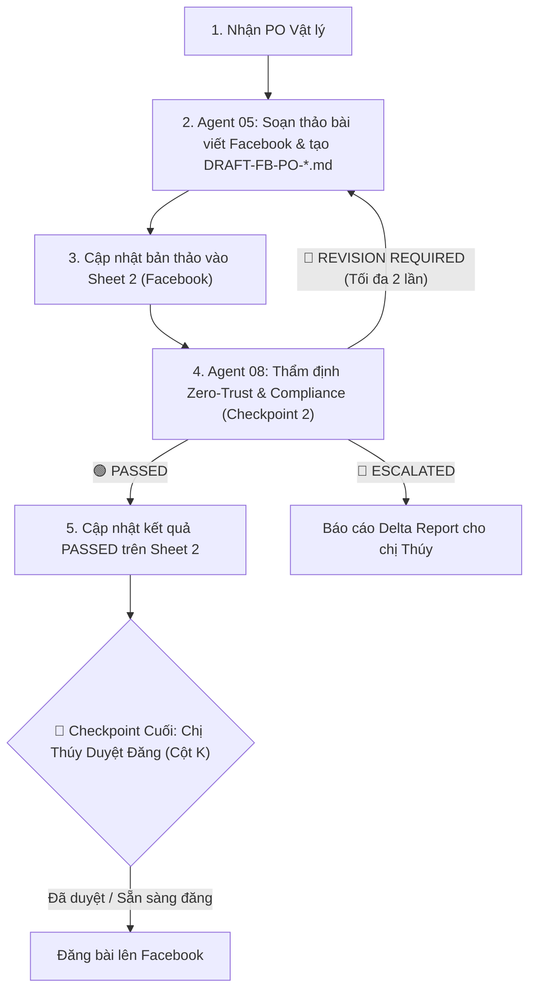

# WORKFLOW 02: SẢN XUẤT BÀI VIẾT FACEBOOK (FACEBOOK CONTENT PRODUCTION)

*Mã quy trình:* `wf02`  
*Mục tiêu:* Tiếp nhận Phiếu Giao việc (PO) vật lý để soạn thảo bài viết Facebook hoàn chỉnh (mộc mạc, từ viết tắt tự nhiên, đặt vấn đề tranh luận, CTA điều hướng YouTube), cập nhật vào Sheet 2 và thẩm định pháp lý/từ cấm qua Agent 08 trước khi trình duyệt xuất bản.  
*Tác tử tham gia:* **Agent 05 (Copywriter)**, **Agent 08 (Fact Checker)**.

---

## 🧭 1. Điều kiện Tiên quyết & Đầu vào (Prerequisites & Inputs)

- **Điều kiện tiên quyết:** Đã có file Phiếu Giao việc PO vật lý tại `scratch/production_orders/PO-YYYY-WXX-XX.md` (được tạo sau khi duyệt tại `wf01`).
- **Câu lệnh kích hoạt mẫu:** *"Viết bài Facebook theo mã PO-2026-W34-01", "Soạn bài đăng FB hôm nay"*
- **Dữ liệu đầu vào:**
  1. File PO vật lý tương ứng.
  2. [`knowledge/brand_persona.md`](file:///d:/AI%20AGENT%20THUY/AI%20branding/knowledge/brand_persona.md) & [`knowledge/voice_samples.md`](file:///d:/AI%20AGENT%20THUY/AI%20branding/knowledge/voice_samples.md).
  3. [`knowledge/banned_words.md`](file:///d:/AI%20AGENT%20THUY/AI%20branding/knowledge/banned_words.md).

---

## 🔄 2. Các Bước Phối Hợp Chi Tiết (Step-by-Step Execution)

### Bước 1: Tiếp nhận và Phân tích PO (Agent 05)
- Đọc kỹ thông tin trong PO: Mã PO, Nền tảng (Facebook), Pillar, Góc tiếp cận, Chỉ dẫn Đơn giản hóa (ví von), Từ khóa SEO, Từ cấm, Dữ liệu SSoT.

### Bước 2: Soạn thảo Bài viết Facebook Hoàn chỉnh (Agent 05)
- **Văn phong & Quy chuẩn Facebook:**
  - Áp dụng cấu trúc Problem-First, chia sẻ trải nghiệm chân thật.
  - Sử dụng từ viết tắt MXH tự nhiên: `mng`, `dn`, `sp`, `kh`, `hq`, `b/l`, `tq`, `xnk`.
  - Tuyệt đối loại bỏ từ ngữ AI sáo rỗng hoặc trịnh trọng (*"nhiều bác nghĩ"*, *"than thở"*...).
  - CTA theo công thức: **Value-first Gating** (tặng tài liệu/biểu mẫu để inbox/comment) + **Cross-platform** (điều hướng xem video chuyên sâu trên YouTube qua link ở bình luận đầu).
- **Lưu trữ tệp nguồn:** Tạo file bản thảo tại: `scratch/production_orders/DRAFT-FB-PO-YYYY-WXX-XX.md`.

### Bước 3: Cập nhật Lịch Excel Sheet 2 (Agent 05)
- Ghi nhận thông tin vào **Sheet 2 (Facebook)** của tệp [`Weekly_Content_Calendar.xlsx`](file:///d:/AI%20AGENT%20THUY/AI%20branding/reports/plan1/Weekly_Content_Calendar.xlsx):
  - Cột B: Mã PO
  - Cột D: Tiêu đề / Góc tranh luận
  - Cột E: Từ khóa SEO & Hashtags
  - Cột F: Hyperlink trỏ tới file `DRAFT-FB-PO-*.md`
  - Cột G: Toàn văn bản thảo bài viết
  - Cột H: Visual Brief (mô tả thiết kế hình ảnh)
  - Cột I: Trạng thái mặc định `Chờ thẩm định`

### Bước 4: Thẩm định Chất lượng & Compliance (Agent 08 - Checkpoint 2)
- **Hành động:** 
  - Thực hiện tra cứu Web Search độc lập (Zero-Trust) để kiểm chứng số liệu, văn bản pháp luật, mã HS trong bài viết so với PO gốc.
  - Quét sạch toàn bộ từ cấm, tính từ kịch tính thái quá (*"đau đớn"*, *"giật mình"*...) và đảm bảo đúng tuyến thương mại Trung Quốc/Hàn Quốc - Việt Nam.
- **Cập nhật Excel Sheet 2:**
  - Cột I (**Kết quả Fact-Check**): `🟢 PASSED` hoặc `🔴 REVISION REQUIRED` hoặc `🔴 ESCALATED`.
  - Cột J (**Báo cáo Thẩm định SSoT**): Ghi chi tiết lý do, trích dẫn văn bản xác thực hoặc lỗi cần sửa.

---

## 👥 3. Phê Duyệt Xuất Bản (Chị Thúy)

1. Chị Thúy mở file Excel [`Weekly_Content_Calendar.xlsx`](file:///d:/AI%20AGENT%20THUY/AI%20branding/reports/plan1/Weekly_Content_Calendar.xlsx) tại **Sheet 2**.
2. Kiểm tra bản thảo tại Cột G (hoặc nhấp link tại Cột F để xem file `.md`) và xem kết quả thẩm định tại Cột I/J.
3. Cập nhật Cột K (**Trạng thái Xuất bản**): Chọn `Sẵn sàng đăng` để tiến hành đăng tải lên trang cá nhân/fanpage.
