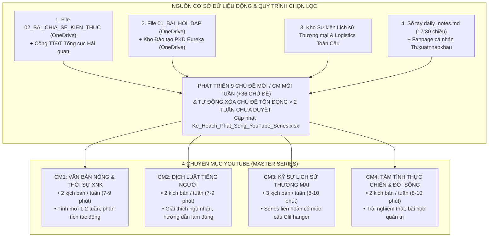
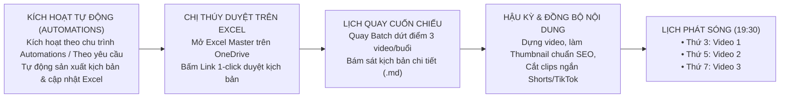
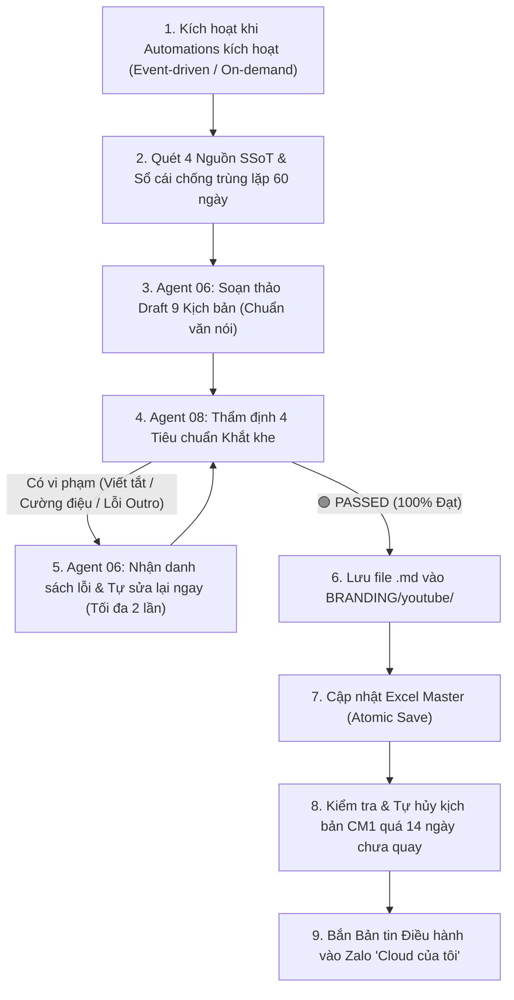

# WORKFLOW 03: TỰ ĐỘNG SẢN XUẤT KỊCH BẢN YOUTUBE MASTER SERIES & CƠ CHẾ XOAY VÒNG HÀNG TUẦN, ĐÀO THẢI TỒN ĐỌNG 2 TUẦN (WEEKLY ROLLING PIPELINE & 2-WEEK STALE PRUNING PROTOCOL)

*Mã quy trình:* `wf03`  
*Mục tiêu:* Tự động hóa toàn diện chu trình sản xuất kịch bản video YouTube cho kênh "ThuyTalk" của Chị Thúy (Nhà sáng lập Eureka Logistics), chia thành 4 chuyên mục chuyên sâu: Mỗi tuần tự động phát triển thêm 9 chủ đề mới cho mỗi CM (+36 chủ đề/tuần) từ 4 nguồn tri thức sống; đồng thời tự động rà soát và XÓA BỎ các chủ đề đề xuất từ 2 tuần trước đó mà KHÔNG ĐƯỢC CHỊ THÚY BÁO DUYỆT VIẾT KỊCH BẢN CỤ THỂ; bảo lưu vĩnh viễn 100% các chủ đề đã duyệt viết kịch bản hoặc đã hoàn thành; tuân thủ 100% văn nói đời thường mộc mạc, thẩm định đa tầng qua Agent 08 (Loop tự sửa lỗi), tự động lưu trữ kịch bản chi tiết vào thư mục OneDrive và cập nhật bảng kế hoạch phát sóng Excel có Hyperlink 1-click.  
*Tác tử tham gia:* **Agent 06 (Video Scriptwriter)**, **Agent 08 (Fact Checker & Compliance)**, **Orchestrator (Background Automation Engine)**.

---

## 🧭 I. CHÂN DUNG TÁC GIẢ & BỘ GEN NHÂN VẬT (PERSONA DNA)

Mọi kịch bản do AI soạn thảo BẮT BUỘC phải nhập vai chính xác 100% vào hình tượng Chị Thúy:

* **Chủ kênh:** Thúy (Nhà sáng lập & Điều hành Eureka Logistics).
* **Xuất phát điểm thật:** Tốt nghiệp Học viện Ngân hàng (chuyên ngành Kinh doanh quốc tế), không chọn công việc bàn giấy ngân hàng ổn định mà quyết định rẽ ngang sang ngành Xuất nhập khẩu & Logistics đầy sóng gió.
* **Hành trình thực chiến:** Đi lên từ vị trí sales tại công ty startup nhưng việc gì cũng đến tay: từ tìm nguồn hàng, đàm phán giá, đặt booking tàu, gõ chứng từ, khai tờ khai hải quan đến cân đối hóa đơn tài chính. Lô hàng đầu đời (mỹ phẩm) lãi đúng 2 triệu đồng nhưng nếm đủ kiếp nạn Cổng thông tin một cửa và C/O 3 bên ủy thác.
* **Xưng hô chuẩn:** `Thúy / Mình` – `Các bạn / Mọi người`.
* **4 Nguyên tắc văn phong tối cao:**
  1. **100% VĂN NÓI ĐỜI THƯỜNG:** Giọng văn mộc mạc, bình dị, tự nhiên như hai người bạn ngồi uống nước nói chuyện ngoài đời thực. Viết để người nói mở miệng ra là nói được ngay, không vấp, không gượng gạo.
  2. **TUYỆT ĐỐI CẤM TEEN CODE & TỪ VIẾT TẮT:** Nghiêm cấm viết tắt kiểu `mng`, `dn`, `sp`, `kh`, `hq`, `b/l`, `xnk` trong lời thoại. Tất cả các từ phải viết đủ chữ để người đọc tròn vành rõ chữ.
  3. **TUYỆT ĐỐI KHÔNG DÙNG TÍNH TỪ CƯỜNG ĐIỆU / VĂN HOA:** Cấm các từ giật gân, hoa mỹ sáo rỗng (*"chấn động"*, *"rúng động"*, *"kinh hoàng"*, *"nghìn cân treo sợi tóc"*, *"lằn ranh sinh tử"*, *"hoa hồng"*, *"bàn trà thanh tịnh"*...).
  4. **OUTRO 100% TỰ DẶN LÒNG (KHÔNG DẠY ĐỜI):** Đoạn kết video luôn là chiêm nghiệm cá nhân của Thúy (*"Với bản thân Thúy, mình tự dặn lòng..."*, *"Sau cú vấp đó, bài học lớn nhất mà mình rút ra là..."*). Tuyệt đối không lên lớp, không khuyên răn hay dạy bảo người xem.

---

## 📊 II. BẢN ĐỒ CƠ SỞ DỮ LIỆU ĐỘNG & CƠ CHẾ XOAY VÒNG HÀNG TUẦN, ĐÀO THẢI TỒN ĐỌNG 2 TUẦN (WEEKLY ROLLING PIPELINE & 2-WEEK STALE PRUNING PROTOCOL)

Hệ thống vận hành theo **Quy chế Xoay Vòng Hàng Tuần & Đào Thải Tồn Đọng 2 Tuần (Không nhân đôi máy móc)**:
- **Mỗi tuần phát triển thêm 9 chủ đề mới mỗi CM (+36 chủ đề/tuần):** Ở mỗi chu kỳ tuần sản xuất (W45, W46, W47...), hệ thống tự động nghiên cứu, đề xuất thêm đúng 9 chủ đề mới cho mỗi chuyên mục (`CM1`, `CM2`, `CM3`, `CM4`) nạp vào `Ke_Hoach_Phat_Song_YouTube_Series.xlsx`.
- **Cơ chế Đào thải Tự động (2-Week Stale Pruning):** Quét toàn bộ các chủ đề đã được đề xuất từ **2 tuần trước đó** (>= 14 ngày). Nếu chủ đề đó **KHÔNG ĐƯỢC CHỊ THÚY BÁO DUYỆT VIẾT KỊCH BẢN CỤ THỂ** (vẫn ở trạng thái "Chờ duyệt", chưa được đánh dấu duyệt hay chưa có link kịch bản chi tiết) ➔ **HỆ THỐNG TỰ ĐỘNG XÓA BỎ DÒNG ĐÓ KHỎI FILE EXCEL**.
- **Cơ chế Bảo lưu Vĩnh viễn (Approval Retention):** Các chủ đề **ĐÃ ĐƯỢC CHỊ THÚY DUYỆT VIẾT KỊCH BẢN** (`🟢 ĐÃ HOÀN THÀNH KỊCH BẢN`, `🟢 ĐÃ DUYỆT VIẾT KỊCH BẢN`...) ➔ **BẢO LƯU VĨNH VIỄN 100%**. Các chủ đề mới đưa vào trong vòng 2 tuần gần nhất ➔ Tiếp tục lưu lại để Chị Thúy cân nhắc duyệt.
- **Cột Theo Dõi:** Quản lý qua cột `Tuần Đề Xuất` (ví dụ: `W45/2026`, `W46/2026`...) để đối chiếu hạn đào thải 2 tuần.

### 1. Chuyên mục 1: VĂN BẢN NÓNG & THỜI SỰ XNK (2 Kịch bản / tuần)
* **Bản chất & Khung thời gian khắt khe (Trong vòng 1 tháng trở lại đây - Zero Stale Laws Rule):** 
  - Toàn bộ đề tài đề xuất mới cho CM1 BẮT BUỘC 100% phải lấy từ các thông tư, công văn hỏa tốc, nghị định, quyết định, chính sách hoặc dự thảo được ban hành hoặc có hiệu lực **TRONG VÒNG 1 THÁNG (30 NGÀY) TRỞ LẠI ĐÂY** tính từ thời điểm tuần hiện tại.
  - **TUYỆT ĐỐI CẤM LẤY VĂN BẢN CŨ CÁC NĂM TRƯỚC (2025, 2024...):** Nghiêm cấm đưa các văn bản ban hành từ các năm trước hoặc đã cũ vào CM1 làm tin nóng. Nếu là văn bản nền tảng giải thích bản chất, ngộ nhận hay quy tắc kinh điển thì BẮT BUỘC phải chuyển sang **CM2: Dịch luật ra tiếng người**, tuyệt đối không được đưa vào CM1.
* **Thời lượng:** 5 – 7 phút (~750 – 900 từ).
* **Nguồn dữ liệu SSoT:** `02_BAI_CHIA_SE_KIEN_THUC_GROUP_FACEBOOK.xlsx` + Cổng TTĐT Tổng cục Hải quan (customs.gov.vn), Bộ Tài chính, Bộ Công Thương, Cục Phòng vệ thương mại.
* **Quy tắc Tự hủy 14 ngày (Bắt buộc):** Nếu kịch bản CM1 đã tạo ra mà sau 14 ngày Chị Thúy chưa bấm quay, hệ thống tự động xóa file `.md` và hủy dòng trong Excel để tránh tồn kho văn bản cũ.
* **Cơ chế Fallback khi hạn hán văn bản mới:** Nếu tuần đó không có công văn mới ban hành, AI tự động cào sâu vào các cuộc tranh luận, phản ánh gay gắt trên 6 hội nhóm Facebook trong 7–14 ngày gần nhất để chọn đề tài nóng trong cộng đồng.

### 2. Chuyên mục 2: DỊCH LUẬT TIẾNG NGƯỜI (2 Kịch bản / tuần)
* **Bản chất:** Giải thích các **NGỘ NHẬN KINH NIÊN, KHÁI NIỆM HAY BỊ HIỂU SAI / LÀM SAI** (EXW vs FCA, mã A11 vs A12, C/O Form E 3 bên, gỡ nợ thuế đất phi nông nghiệp...).
* **Thời lượng:** 5 – 6 phút (~700 – 850 từ).
* **Nguồn dữ liệu:** `01_BAI_HOI_DAP_GROUP_FACEBOOK.xlsx` + Kho đào tạo nội bộ Eureka tại `OneDrive\Phòng Kinh doanh - Eureka - Tài liệu\3. ĐÀO TẠO VÀ TUYỂN DỤNG PKD`.

### 3. Chuyên mục 3: KÝ SỰ LỊCH SỬ THƯƠNG MẠI & KỲ ÁN HÀNG HẢI (3 Kịch bản / tuần)
* **Bản chất:** Kể chuyện (Storytelling) lịch sử thương mại, kỳ án chuỗi cung ứng thế giới và Việt Nam. Bắt buộc đóng gói thành **Series 3 tập liên hoàn**, cuối tập 1 & 2 có **móc câu Cliffhanger** kịch tính.
* **Thời lượng:** 6 – 8 phút/tập (~800 – 1.000 từ).
* **Nguồn dữ liệu:** Duy nhất từ các chủ đề được Chị Thúy chọn lọc và note `"Đã duyệt"` trong Sheet `CM3_LICH_SU_THUONG_MAI` của file Master Series `Ke_Hoach_Phat_Song_YouTube_Series.xlsx`. AI nghiên cứu sâu và bám sát căn cứ lịch sử chính thống (không tự ý lấy từ Weekly_Content_Calendar).
* **ĐỊNH VỊ THỊ GIÁC ĐỘC TÔN (ZERO TALKING-HEAD):**
  - 100% sản xuất dưới dạng **Video AI Giấu Mặt (Faceless Video) phong cách Hoạt hình Người Que 2D Doodle tối giản (2D Minimalist Doodle Stick Figure Animation)** trên nền trắng sạch sẽ (`pure white background`), nét vector đen sắc nét, điểm xuyết màu vàng rực và xanh cyan.
  - Nhân vật đại diện xuyên suốt: **Cô bé người que Thúy buộc tóc đuôi ngựa thắt nơ vàng** (`Cute 2D female stick figure named Thuy with signature high ponytail tied with vibrant yellow ribbon...`).
* **QUY CHUẨN XUẤT FILE TỰ ĐỘNG (KẾ THỪA SKILL THUYTALK-CM3 & AI-VIDEO-PRODUCER-PRO):**
  - Ngay khi Chị Thúy note `"Đã duyệt"`, hệ thống tự động kích hoạt `scripts/generate_cm3_storyboard_pipeline.py` để xuất trọn bộ:
    1. `<Ten_Du_An>_Kich_Ban_Flow.csv` (Chuẩn 6 cột Google Flow theo RULE 13).
    2. `<Ten_Du_An>_Tao_Anh_Hang_Loat.csv` (Chuẩn 5 cột tạo ảnh theo RULE 14).
    3. `<Ten_Du_An>_Studio.xlsx` (Workbook 4 Sheet chuyên nghiệp theo RULE 16G).
    4. Cập nhật kịch bản Markdown 2D Doodle và tự động gắn link 1-click đến file Excel Studio trên OneDrive.

### 4. Chuyên mục 4: TÂM TÌNH THỰC CHIẾN XNK & ĐỜI SỐNG (2 Kịch bản / tuần)
* **Bản chất:** Trải nghiệm thật, góc nhìn quản trị và chiêm nghiệm cuộc sống của nữ chủ doanh nghiệp.
* **Thời lượng:** 5 – 7 phút (~750 – 900 từ).
* **Nguồn dữ liệu:** `scratch/daily_notes.md` ghi nhận lúc 17:30 + Fanpage `Th.xuatnhapkhau`. Nếu thiếu nhật ký, AI kích hoạt kho case study nhân sự Eureka.

---

## 🗓️ III. LỊCH TRÌNH VẬN HÀNH & PHÁT SÓNG ĐẦU TUẦN

* **Kích hoạt tự động khi Automations kích hoạt:** Quy trình sản xuất kịch bản YouTube **KHÔNG BỊ RÀNG BUỘC CỐ ĐỊNH VÀO 9H THỨ 6**. Script được kích hoạt tự động bất cứ khi nào hệ thống Automations kích hoạt (Automation-triggered / Pipeline Automation / Theo yêu cầu / Event-driven). Khi kích hoạt, hệ thống tự động quét kho đề tài, sản xuất các kịch bản đang chờ (pending), thẩm định fact-check, đồng bộ lên OneDrive và gửi báo cáo Zalo vào "Cloud của tôi".
* **Chị Thúy duyệt kịch bản linh hoạt & Kích hoạt sản xuất tức thì:** Xem bản tin Zalo hoặc mở file Excel Master trên OneDrive để duyệt chủ đề. Khi Chị Thúy đổi Cột 12 (`Trạng Thái Xem Xét`) thành `Đã duyệt` / `Duyệt quay` / `OK`, hệ thống Automations khi quét qua sẽ tự động bóc tách toàn bộ luận điểm cốt lõi, nguồn SSoT, Hook và Outro để sinh kịch bản chi tiết (.md), thẩm định Fact-Check và tự động dẫn link Hyperlink 1-click vào file Excel ngay lập tức!
* **Quay cuốn chiếu (Batch Recording):** Chị Thúy bấm link trong Excel mở kịch bản chi tiết ➔ Thực hiện quay cuốn chiếu 1 buổi dứt điểm 3 tập.
* **Hậu kỳ & đóng gói:** Đội ngũ Hậu kỳ dựng phim, chèn visual, làm Thumbnail YouTube chuẩn SEO, cắt Shorts 60s.
* **Lập lịch phát sóng:** Đều đặn **3 video/tuần** vào **Thứ 3 – Thứ 5 – Thứ 7 lúc 19:30**.

---

## 📂 IV. CẤU TRÚC LƯU TRỮ & DẪN XUẤT HYPERLINK ONEDRIVE

1. **File Kế Hoạch Chung (Excel Master trên OneDrive):**
   - **Đường dẫn:** `C:\Users\thuyn\OneDrive - EUREKA TRADE AND IMPORT EXPORT COMPANY LIMITED\BRANDING\Ke_Hoach_Phat_Song_YouTube_Series.xlsx`
   - **Cột Hyperlink 1-Click:** Mỗi kịch bản bắt buộc có cột `Link Kịch Bản Chi Tiết (.md)` với công thức:
     `=HYPERLINK("C:\Users\thuyn\OneDrive - EUREKA TRADE AND IMPORT EXPORT COMPANY LIMITED\BRANDING\youtube\[Tên_File].md", "👉 Xem Kịch Bản Chi Tiết")`
   - **Lưu file an toàn (Atomic Save):** Bắt buộc ghi ra file tạm `.tmp.xlsx` rồi dùng `os.replace` để tránh xung đột đồng bộ OneDrive.

2. **Thư Mục Lưu Trữ Kịch Bản Chi Tiết (.md):**
   - **Đường dẫn:** `C:\Users\thuyn\OneDrive - EUREKA TRADE AND IMPORT EXPORT COMPANY LIMITED\BRANDING\youtube\`
   - **Quy tắc đặt tên file:** `[Mã_Chuyên_Mục]-[Mã_Chủ_Đề]_[Tên_Ngắn_Gọn].md` (Ví dụ: `CM1-CD02_Nghi_Dinh_37_Hai_Quan.md`, `CM3-CD01_E01_Container_Malcolm_McLean.md`).

---

## ⚙️ V. CÁC BƯỚC THỰC THI CHI TIẾT & VÒNG LẶP TỰ SỬA LỖI (AUTO-REFINE LOOP)

### Bước 1: Quét Nguồn Dữ Liệu, Trùng Lặp & Kiểm Tra Phê Duyệt Của Chị Thúy
* **Kiểm tra trạng thái duyệt (Approval-Driven Production):** Quét cột `Trạng Thái Xem Xét` (Cột 12) trên cả 4 sheet của `Ke_Hoach_Phat_Song_YouTube_Series.xlsx`. Bất kỳ chủ đề nào được Chị Thúy đổi trạng thái thành `Đã duyệt`, `Duyệt quay`, `Duyệt sản xuất`, `🟢 Đã duyệt`, `OK`, `Thúy duyệt`... mà chưa có file kịch bản vật lý ➔ Hệ thống lập tức kích hoạt chu trình **Tự Động Sản Xuất Kịch Bản Chi Tiết (.md)** và gán Hyperlink 1-click tức thì.
* Agent 01/06 đọc 4 nguồn SSoT.
* Đọc toàn bộ các chủ đề đã có trong file Excel `Ke_Hoach_Phat_Song_YouTube_Series.xlsx`. Nếu chủ đề đã xuất hiện trong vòng 60 ngày qua ➔ Tự động bỏ qua để chọn chủ đề mới.
* Nếu CM1 thiếu văn bản mới ➔ Tự động cào thêm các bài thảo luận nóng trên các nhóm Facebook.

### Bước 2: Soạn Thảo Kịch Bản (Agent 06) — Chuẩn Giữ Chân Khán Giả Clip Dài (Retention Formula)

#### A. Đối với CM1, CM2, CM4 (Trò chuyện & Kể chuyện thực chiến - Kỹ năng `thuytalk-cm124`):
* **Kỹ năng chuyên trách bắt buộc:** [`C:\Users\thuyn\.gemini\config\skills\thuytalk-cm124\SKILL.md`](file:///C:/Users/thuyn/.gemini/config/skills/thuytalk-cm124/SKILL.md) (lệnh kích hoạt: `/thuytalk-cm124`, `/thuytalk-script`, `/thuytalk-spoken`, `/thuytalk-talk`).
Mọi kịch bản CM1, CM2, CM4 bắt buộc tuân thủ **Cấu trúc 5 Hồi Giữ Chân Khán Giả** kèm **4 Móc Câu Chuyển Tiếp (Transitional Bridges)** và **Tách Riêng 1 Phần Kịch Bản Nói**:

1. **Phần 1: Thông tin hành chính & Chỉ dẫn kỹ thuật** (Metadata, bối cảnh, đạo cụ, căn cứ SSoT).
2. **Phần 2: Kịch bản thuyết minh thuần văn nói riêng biệt (Full Spoken Script)**:
   * **Hồi 1 (Hook 0:00 - 0:45):** Đặt vấn đề giật mình, con số thiệt hại thực tế ➔ *[Câu dẫn chuyển tiếp 1 kéo sang Phân tích]*
   * **Hồi 2 (Phân tích thực trạng & Ví dụ cụ thể 0:45 - 3:00):** Bóc tách bản chất quy định, **BẮT BUỘC CÓ VÍ DỤ CỤ THỂ ĐỂ LIÊN TƯỞNG**. Tuyệt đối KHÔNG nói theo kiểu "mình có kinh nghiệm xử lý" hay khoe thành tích, mà dẫn dắt khách quan, khiêm tốn theo dạng: *"Thử tưởng tượng..."*, *"Giả sử..."*, *"Ví dụ như..."*, *"Nếu như..."*, hoặc *"Hãy xem case study thực tế này: Mới đây trên một hội nhóm xuất nhập khẩu, có một bạn đăng bài hỏi..."* (tự động đào từ kho `01_BAI_HOI_DAP_GROUP_FACEBOOK.xlsx`) ➔ *[Câu dẫn chuyển tiếp 2 kéo sang Giải pháp]*
   * **Hồi 3 (Giải pháp thực chiến Step-by-Step 3:00 - 5:30):** 3 bước gỡ rối, checklist tài liệu, cách làm đúng luật ➔ *[Câu dẫn chuyển tiếp 3 kéo sang Liên tưởng mở rộng]*
   * **Hồi 4 (Liên tưởng mở rộng & Tác động thị trường 5:30 - 7:00):** Tác động đến dòng tiền, uy tín xếp hạng luồng xanh/đỏ, xu hướng quản lý 1–2 năm tới ➔ *[Câu dẫn chuyển tiếp 4 kéo vào Kết bài]*
   * **Hồi 5 (Kết thúc mở & Outro tự dặn lòng 7:00 - 8:30):** Đúc kết tự dặn lòng mộc mạc của Thúy (tuyệt đối không dạy đời) + **Kết thúc mở** bằng câu hỏi gợi mở để khán giả tranh luận, để lại bình luận.

> [!CAUTION]
> **QUY TẮC CHỐNG HIỂU NHẦM VỀ CÂU DẪN CHUYỂN TIẾP (TRANSITIONAL BRIDGES):**  
> * **"Bắt buộc" là bắt buộc về MẶT KỸ THUẬT CẤU TRÚC (Script Architecture):** Giống như kỹ thuật mini-cliffhanger giữa các phân đoạn video để người nghe không bị đứt mạch cảm xúc và tò mò nghe tiếp.  
> * **TUYỆT ĐỐI CẤM RẬP KHUÔN / VĂN MẪU (ZERO COOKIE-CUTTER):** Không bao giờ dùng một câu dẫn mẫu lặp lại cho mọi kịch bản. Câu từ phải được **"ĐO NI ĐÓNG GIÀY" riêng cho từng chủ đề**:  
>   - ❌ **SAI (Rập khuôn máy móc):** Kịch bản nào cuối Hook cũng viết: *"Nhiều người nghĩ đây chỉ là một sự cố giấy tờ nhỏ nhặt... Thúy sẽ chỉ rõ cho các bạn thấy ngay sau đây."* (Khán giả nghe 2 video là nhận ra máy móc ngay).  
>   - ✅ **ĐÚNG (Biến hóa theo đề tài & từ khóa):**  
>     + *CM1 (Hóa đơn ma):* *"Nhiều người vẫn nghĩ những quy định về siết hóa đơn điện tử chỉ là câu chuyện hành chính giấy tờ xa vời. Nhưng tại sao cơ quan chức năng lại siết chặt ngay vào lúc này và rủi ro từ công ty 'ma' có thể khiến doanh nghiệp mất trắng chi phí được trừ? Thúy sẽ bóc tách ngay sau đây:"*  
>     + *CM2 (Sau thông quan):* *"Nhiều người cứ nghĩ hàng về kho là kê cao gối ngủ ngon. Nhưng tại sao kiểm tra sau thông quan 5 năm lại là 'cơn ác mộng' khiến doanh nghiệp bị truy thu tiền tỷ? Những điểm tử huyệt mà đoàn kiểm tra soi kỹ nhất là gì?"*  
>     + *CM4 (Chuyện nghề / 1 điểm chạm):* *"Người ngoài nhìn vào logistics thường chỉ thấy những dòng tiền hàng tỷ đồng. Nhưng những góc khuất, những cái giá phải trả và những đêm mất ngủ đằng sau sự hỗn loạn 'đá bóng trách nhiệm' giữa các phòng ban là gì?"*

3. **Phần 3: Bảng phân cảnh gợi ý Visual / B-Roll / Screencast** (Mốc giây, góc quay, nội dung b-roll hỗ trợ).
4. **Phần 4: Báo cáo thẩm định Fact-Check (Agent 08)**.

#### B. Đối với CM3 (Ký sự lịch sử thương mại & logistics):
* 100% video AI giấu mặt (Faceless), hoạt hình người que 2D Doodle tối giản (Cô bé Thúy nơ vàng).
* Xuất trọn bộ 3 tệp tin Studio: `_Kich_Ban_Flow.csv` (6 cột), `_Tao_Anh_Hang_Loat.csv` (5 cột), `_Studio.xlsx` (4 sheet) qua `generate_cm3_storyboard_pipeline.py`.

### Bước 3: Thẩm Định Đa Tầng & Vòng Lặp Tự Sửa Lỗi (Agent 08)
Agent 08 quét toàn văn bản thảo qua 5 bộ lọc khắt khe:
1. Có từ viết tắt / teen code không? (`mng`, `dn`, `sp`, `kh`, `hq`, `b/l`...).
2. Có từ ngữ cường điệu, văn hoa sáo rỗng không? (*"chấn động"*, *"nghìn cân treo sợi tóc"*...).
3. Outro có mang tính chất dạy đời không?
4. Căn cứ pháp lý, số hiệu công văn có chính xác 100% không?
5. **Tiêu chuẩn thời gian CM1 (Trong vòng 1 tháng trở lại đây - REJECT nếu là văn bản cũ):** Đối với kịch bản thuộc CM1 (Văn bản nóng), văn bản/chính sách được phân tích BẮT BUỘC phải ban hành hoặc có hiệu lực trong vòng tối đa 30 ngày (1 tháng) trở lại đây tính từ tuần hiện tại. Nếu phát hiện đưa văn bản cũ của những năm trước (2025, 2024...) vào làm chủ đề tin nóng CM1 ➔ **REJECT NGAY LẬP TỨC** và yêu cầu đổi sang văn bản mới trong tháng!
* *Nếu có lỗi:* Trả về chi tiết dòng vi phạm để Agent 06 viết lại ngay lập tức (tối đa 2 vòng lặp) trước khi ghi file.

### Bước 4: Lưu File OneDrive & Tự Hủy CM1 Hết Hạn
* Lưu 9 file `.md` vào `BRANDING\youtube\`.
* Mở file `Ke_Hoach_Phat_Song_YouTube_Series.xlsx`, cập nhật thông tin và công thức `=HYPERLINK(...)`.
* Quét cột `Ngày Tạo` của sheet `CM1_VAN_BAN_NONG`: Nếu kịch bản nào có tuổi > 14 ngày mà `Trạng Thái` chưa phải là `Đã quay` ➔ Tự động xóa file `.md` và chuyển trạng thái thành `ĐÃ HỦY (QUÁ 14 NGÀY)`.

### Bước 5: Báo Cáo Điều Hành Qua Zalo Bot
* Soạn bản tin tóm tắt danh sách 9 kịch bản mới vừa tạo.
* Gợi ý rõ **Top 3 kịch bản ưu tiên quay trong tuần tới**.
* Bắn tin nhắn trực tiếp vào Zalo *"Cloud của tôi"*.

---

## 🚀 VI. SCRIPT THỰC THI & CƠ CHẾ KÍCH HOẠT TỰ ĐỘNG (AUTOMATIONS TRIGGER)

* **Script Python tự động:** [`scripts/auto_generate_youtube_weekly.py`](file:///d:/AI%20AGENT%20THUY/AI%20branding/scripts/auto_generate_youtube_weekly.py)
* **File kích hoạt thủ công / Test nhanh:** [`chay_tu_dong_youtube.bat`](file:///d:/AI%20AGENT%20THUY/AI%20branding/chay_tu_dong_youtube.bat)
* **Cơ chế kích hoạt:** 
  - **Kích hoạt tự động bởi Automations:** Tự động thực thi bất cứ khi nào hệ thống Automations của Antigravity hoặc background pipeline kích hoạt, hoặc khi có đợt sản xuất nội dung mới, **KHÔNG phụ thuộc hay chờ đợi cố định vào 9h sáng Thứ Sáu**.
  - **Kích hoạt theo yêu cầu (On-demand):** Bất cứ khi nào người dùng hoặc pipeline gọi thực thi, script sẽ quét toàn bộ các kịch bản đang chờ (`Pending` / `Chờ sản xuất`) trong file Excel Master OneDrive và `Weekly_Content_Calendar.xlsx` để tiến hành sản xuất dứt điểm, kiểm tra Zero-Trust và đồng bộ tức thì.
  - **Cơ chế tự hủy CM1 (14 ngày):** Tự động phát hiện và hủy các kịch bản văn bản nóng CM1 quá hạn 14 ngày chưa quay mỗi khi script chạy.
