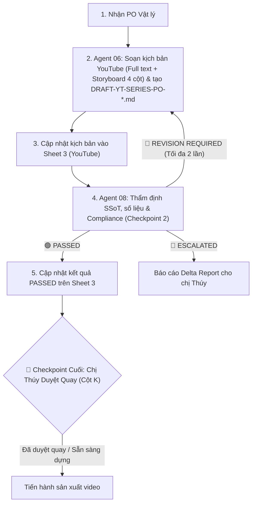

# WORKFLOW 03: SẢN XUẤT KỊCH BẢN YOUTUBE (YOUTUBE SCRIPT & SERIES PRODUCTION)

*Mã quy trình:* `wf03`  
*Mục tiêu:* Tiếp nhận Phiếu Giao việc (PO) vật lý để soạn thảo kịch bản video YouTube dài (5-15 phút) hoặc Video Series nhiều tập kèm Storyboard 4 cột và Cliffhanger Outro kịch tính, cập nhật vào Sheet 3 và thẩm định pháp lý/từ cấm qua Agent 08 trước khi duyệt quay.  
*Tác tử tham gia:* **Agent 06 (Video Scriptwriter)**, **Agent 08 (Fact Checker)**.

---

## 🧭 1. Điều kiện Tiên quyết & Đầu vào (Prerequisites & Inputs)

- **Điều kiện tiên quyết:** Đã có file Phiếu Giao việc PO vật lý tại `scratch/production_orders/PO-YYYY-WXX-XX.md`.
- **Câu lệnh kích hoạt mẫu:** *"Làm kịch bản YouTube theo mã PO-2026-W34-02", "Soạn kịch bản video series"*
- **Dữ liệu đầu vào:**
  1. File PO vật lý tương ứng.
  2. [`knowledge/brand_persona.md`](file:///d:/AI%20AGENT%20THUY/AI%20branding/knowledge/brand_persona.md) & [`knowledge/voice_samples.md`](file:///d:/AI%20AGENT%20THUY/AI%20branding/knowledge/voice_samples.md).
  3. [`knowledge/banned_words.md`](file:///d:/AI%20AGENT%20THUY/AI%20branding/knowledge/banned_words.md).

---

## 🔄 2. Các Bước Phối Hợp Chi Tiết (Step-by-Step Execution)

### Bước 1: Tiếp nhận và Phân tích PO (Agent 06)
- Đọc kỹ PO: Mã PO, Nền tảng (YouTube), Thời lượng dự kiến (5-15 phút), Pillar (HT/CS/FF/TN), Góc tiếp cận, Dữ liệu kỹ thuật/SSoT.

### Bước 2: Soạn thảo Kịch bản YouTube Hoàn chỉnh (Agent 06)
- **Cấu trúc File Kịch bản Bắt buộc (2 Phần):**
  1. **Phần 1: Bài Viết Lời Thoại Hoàn Chỉnh (Full Text Script for Narration / Repurpose):** Toàn văn lời thoại liền mạch để chị Thúy đọc máy quay hoặc dùng đăng lại thành bài viết dài.
  2. **Phần 2: Bảng Phân Cảnh Chi Tiết (Storyboard Script 4 cột):**
     | Phân đoạn / Thời gian | Visual (Hình ảnh / Bối cảnh) | Audio (Lời thoại / Giọng đọc) | Text On Screen & SFX |
     |---|---|---|---|
     | `[0:00 - 0:45] HOOK` | Chị Thúy ngồi tại bàn làm việc, ánh mắt sắc sảo... | "..." | Text động cảnh báo rủi ro |
     | `[0:45 - 5:30] THÂN BÀI` | Screencast phần mềm ECUS, đồ họa bảng so sánh... | "..." | Zoom cận mã HS Code |
     | `[5:30 - 7:00] OUTRO` | **Cliffhanger Outro (Gợi mở kịch tính tập sau)**... | "..." | Card kết thúc & Link video liên quan |
- **Lưu trữ tệp nguồn:** Tạo file bản thảo tại: `scratch/production_orders/DRAFT-YT-SERIES-PO-YYYY-WXX-XX.md`.

### Bước 3: Cập nhật Lịch Excel Sheet 3 (Agent 06)
- Ghi nhận thông tin vào **Sheet 3 (YouTube)** của tệp [`Weekly_Content_Calendar.xlsx`](file:///d:/AI%20AGENT%20THUY/AI%20branding/reports/plan1/Weekly_Content_Calendar.xlsx):
  - Cột B: Mã PO
  - Cột D: Tên Series & Số tập
  - Cột E: Từ khóa SEO YouTube & Tags
  - Cột F: Hyperlink trỏ tới file `DRAFT-YT-SERIES-PO-*.md`
  - Cột G: Toàn bộ kịch bản mốc thời gian chi tiết
  - Cột H: Chỉ dẫn quay, bối cảnh, Screencast ECUS
  - Cột I: Trạng thái mặc định `Chờ thẩm định`

### Bước 4: Thẩm định Chất lượng & Pháp lý (Agent 08 - Checkpoint 2)
- **Hành động:** 
  - Tra cứu Web Search đối chiếu số liệu, mã HS, quy trình kỹ thuật so với PO.
  - Quét sạch từ cấm và đảm bảo có đoạn kết Cliffhanger Outro đúng quy chuẩn.
- **Cập nhật Excel Sheet 3:**
  - Cột I (**Kết quả Fact-Check**): `🟢 PASSED` hoặc `🔴 REVISION REQUIRED` hoặc `🔴 ESCALATED`.
  - Cột J (**Báo cáo Thẩm định SSoT**): Ghi chi tiết kết quả đối chiếu.

---

## 👥 3. Phê Duyệt Xuất Bản (Chị Thúy)

1. Chị Thúy mở file Excel [`Weekly_Content_Calendar.xlsx`](file:///d:/AI%20AGENT%20THUY/AI%20branding/reports/plan1/Weekly_Content_Calendar.xlsx) tại **Sheet 3**.
2. Đọc kịch bản tại Cột G (hoặc nhấp link tại Cột F để xem toàn văn file `.md`) và xem kết quả thẩm định tại Cột I/J.
3. Cập nhật Cột K (**Trạng thái Xuất bản**): Chọn `Đã duyệt quay` hoặc `Sẵn sàng dựng`.
