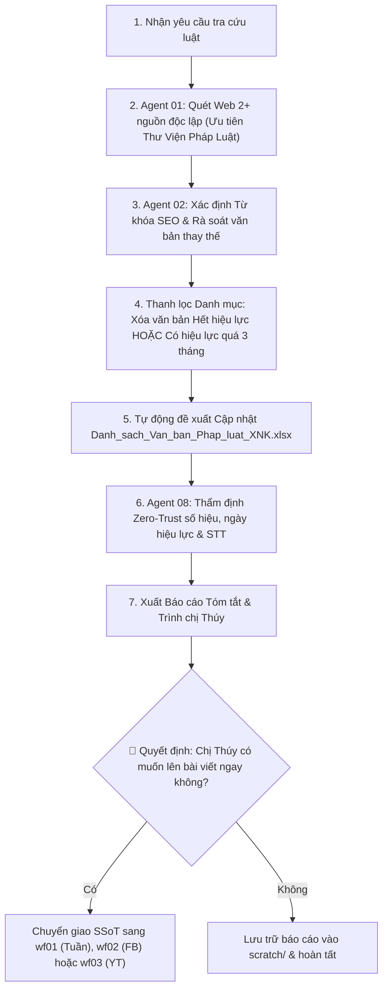

# WORKFLOW 04: NGHIÊN CỨU NHANH VĂN BẢN PHÁP LUẬT MỚI (AD-HOC LEGAL RESEARCH)

*Mã quy trình:* `wf04`  
*Mục tiêu:* Tiếp nhận một Nghị định, Thông tư, Công văn mới hoặc yêu cầu tra cứu pháp lý bất kỳ từ chị Thúy để quét dữ liệu gốc (SSoT từ 2+ nguồn độc lập, ưu tiên Thư Viện Pháp Luật), phân tích tác động, đề xuất từ khóa SEO, đối chiếu trạng thái hiệu lực, tự động thanh lọc các văn bản cũ/hết hiệu lực và cập nhật vào file Excel luật XNK.  
*Tác tử tham gia:* **Agent 01 (Research)**, **Agent 02 (SEO & Policy)**, **Agent 08 (Fact Checker)**, **Agent 00 (Điều phối)**.

---

## 🧭 1. Điều kiện Kích hoạt & Đầu vào (Trigger & Inputs)

- **Câu lệnh kích hoạt mẫu:** 
  - *"Nghiên cứu Nghị định 36/2026/NĐ-CP"*, *"Tra cứu Thông tư mới về kiểm dịch thực vật"*, *"Văn bản này có hiệu lực chưa?"*
  - *"Xóa các văn bản pháp luật hết hiệu lực hoặc có hiệu lực quá 3 tháng, cập nhật vào wf04"*
- **Dữ liệu đầu vào:**
  1. Tên hoặc số hiệu văn bản pháp lý cần nghiên cứu.
  2. [`reports/Danh_sach_Van_ban_Phap_luat_XNK.xlsx`](file:///d:/AI%20AGENT%20THUY/AI%20branding/reports/Danh_sach_Van_ban_Phap_luat_XNK.xlsx).
  3. Kỹ năng kiểm chứng tri thức gốc [`skills/ssot-research/SKILL.md`](file:///d:/AI%20AGENT%20THUY/AI%20branding/skills/ssot-research/SKILL.md).

---

## 🔄 2. Các Bước Phối Hợp Chi Tiết (Step-by-Step Execution)

### Bước 1: Quét Dữ liệu & Kiểm chứng SSoT (Agent 01)
- **Hành động:** 
  - Thực hiện Web Search tra cứu trực tiếp số hiệu văn bản trên **thuvienphapluat.vn**, **customs.gov.vn**, **chinhphu.vn**, các cổng thông tin Bộ ngành chủ quản (Bộ Tài chính, Bộ Công Thương, Bộ NN&PTNT, Bộ GTVT, Bộ KH&CN).
  - Bắt buộc đối chiếu tối thiểu 2 nguồn độc lập.
  - Trích xuất: Cơ quan ban hành, Ngày ban hành, Ngày có hiệu lực, Trạng thái hiệu lực, Các điều khoản cốt lõi ảnh hưởng trực tiếp đến doanh nghiệp XNK.
- **Đầu ra:** Báo cáo Phân tích Pháp lý & SSoT thô.

### Bước 2: Phân tích SEO, Phản hồi Cập nhật & Thanh lọc Dữ liệu (Agent 02)
- **Hành động:**
  - Xác định cụm từ khóa tìm kiếm phổ biến và search intent xung quanh văn bản mới.
  - **Cơ chế Feedback Loop:** Kiểm tra xem văn bản mới có thay thế/sửa đổi cho văn bản cũ nào trong [`Danh_sach_Van_ban_Phap_luat_XNK.xlsx`](file:///d:/AI%20AGENT%20THUY/AI%20branding/reports/Danh_sach_Van_ban_Phap_luat_XNK.xlsx) không.
  - **Kích hoạt Bộ lọc Thanh lọc Dữ liệu Định kỳ (3-Month Retention Policy):**
    - Kiểm tra toàn bộ cơ sở dữ liệu và tự động loại bỏ:
      1. Văn bản **đã hết hiệu lực** (`Ngày Hết Hiệu Lực <= Ngày hiện tại` hoặc bị thay thế/bãi bỏ hoàn toàn).
      2. Văn bản **đã có hiệu lực quá 3 tháng** (`Ngày Có Hiệu Lực < Ngày hiện tại - 3 tháng`).
    - Chỉ giữ lại các văn bản có hiệu lực trong vòng 3 tháng gần nhất hoặc sắp có hiệu lực trong tương lai.
    - Tự động đánh số lại STT từ 1 đến N liên tục, không để đứt gãy số thứ tự.
- **Đầu ra:** Bảng dữ liệu sạch đã thanh lọc + Đề xuất cập nhật Excel Luật + SEO Brief.

### Bước 3: Thẩm định Tính Chính xác (Agent 08)
- **Hành động:** 
  - Kiểm tra độc lập số hiệu, ngày ký, ngày hiệu lực và trích dẫn điều khoản để đảm bảo không bị ảo giác AI.
  - Thẩm định tính chuẩn xác của bộ lọc 3 tháng và việc đánh lại STT liên tục.
- **Đầu ra:** Xác nhận `🟢 VERIFIED`.

### Bước 4: Trình Báo cáo cho Chị Thúy & Hỏi Ý Kiến
- Agent 00 gửi bản tóm tắt phân tích pháp lý và tình trạng cơ sở dữ liệu kèm câu hỏi:
  > *"Chị Thúy có muốn đưa nội dung phân tích văn bản này vào Lịch tuần (wf01) hoặc viết ngay bài viết Facebook (wf02) / kịch bản YouTube (wf03) không?"*

---

## 🧹 3. Quy Tắc Sàng Lọc & Thanh Lọc Dữ Liệu Định Kỳ (3-Month & Active Validity Policy)

> [!IMPORTANT]
> **TIÊU CHUẨN VÀNG VỀ VÒNG ĐỜI VĂN BẢN TRONG EXCEL:**  
> File Excel [`reports/Danh_sach_Van_ban_Phap_luat_XNK.xlsx`](file:///d:/AI%20AGENT%20THUY/AI%20branding/reports/Danh_sach_Van_ban_Phap_luat_XNK.xlsx) là công cụ phục vụ trực tiếp cho hoạt động Content Marketing & Tư vấn Nghiệp vụ nóng của Eureka Logistics. Do đó, danh mục **BẮT BUỘC LUÔN TINH GỌN VÀ TƯƠI MỚI (MAX 3 MONTHS FRESHNESS)**.

### A. Tiêu chí giữ lại trong file Excel:
1. **Còn hiệu lực:** Trạng thái `"Còn hiệu lực"`, `"Đang áp dụng"`, `"Chưa xác định"` (với các văn bản chưa có quy định thời hạn kết thúc), hoặc có ngày hết hiệu lực trong tương lai.
2. **Độ tuổi hiệu lực $\le$ 3 tháng:** Văn bản có `Ngày Có Hiệu Lực` nằm trong khoảng từ `[Ngày hiện tại - 3 tháng]` đến hiện tại, HOẶC văn bản mới ban hành sắp có hiệu lực trong tương lai.

### B. Tiêu chí tự động xóa khỏi file Excel:
1. **Văn bản hết hiệu lực:** 
   - `Ngày Hết Hiệu Lực` đã qua so với ngày chạy thực tế (`exp_date <= today`).
   - Văn bản có ghi chú hoặc thông báo chính thức bị bãi bỏ, hủy bỏ hoặc thay thế toàn diện.
2. **Văn bản có hiệu lực quá 3 tháng:**
   - `Ngày Có Hiệu Lực` trước mốc 3 tháng so với ngày chạy thực tế (`eff_date < today - 3 months`).
   - *Lý do:* Các văn bản có hiệu lực trên 3 tháng đã trở thành nghiệp vụ vận hành thông thường, không còn tính cấp thiết / tính thời sự để làm đề tài truyền thông, viết bài Facebook hoặc dựng video YouTube.

### C. Quy chuẩn kỹ thuật khi làm sạch & cập nhật:
- **Đánh số lại STT:** Sau khi xóa các dòng thỏa mãn điều kiện loại bỏ, cột `STT` bắt buộc phải được đánh số lại tăng dần liên tục từ 1 đến N (không để khuyết STT).
- **Format hiển thị chuẩn mực:** Font `Segoe UI 10pt`, header xanh navy `#1F4E78` chữ trắng đậm, dòng dữ liệu kẻ zebra striping `#F9FAFB` so le, viền `thin #E5E7EB`, căn giữa STT và các cột ngày tháng.
- **Kỹ thuật Atomic Save (Quy tắc 10 GEMINI.md):** Ghi workbook ra file tạm `.tmp.xlsx` rồi dùng lệnh `os.replace` để ghi đè nguyên tử. **TUYỆT ĐỐI KHÔNG TẠO BẤT KỲ FILE BACKUP NÀO** (`*_backup_*.xlsx`).
- **Đồng bộ OneDrive:** Tự động copy file sạch sang thư mục OneDrive Marketing FB 2026.
