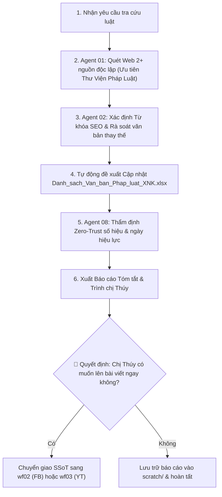

# WORKFLOW 04: NGHIÊN CỨU NHANH VĂN BẢN PHÁP LUẬT MỚI (AD-HOC LEGAL RESEARCH)

*Mã quy trình:* `wf04`  
*Mục tiêu:* Tiếp nhận một Nghị định, Thông tư, Công văn mới hoặc yêu cầu tra cứu pháp lý bất kỳ từ chị Thúy để quét dữ liệu gốc (SSoT từ 2+ nguồn độc lập, ưu tiên Thư Viện Pháp Luật), phân tích tác động, đề xuất từ khóa SEO, đối chiếu trạng thái hiệu lực và cập nhật vào file Excel luật XNK.  
*Tác tử tham gia:* **Agent 01 (Research)**, **Agent 02 (SEO & Policy)**, **Agent 08 (Fact Checker)**.

---

## 🧭 1. Điều kiện Kích hoạt & Đầu vào (Trigger & Inputs)

- **Câu lệnh kích hoạt mẫu:** *"Nghiên cứu Nghị định 36/2026/NĐ-CP", "Tra cứu Thông tư mới về kiểm dịch thực vật", "Văn bản này có hiệu lực chưa?"*
- **Dữ liệu đầu vào:**
  1. Tên hoặc số hiệu văn bản pháp lý cần nghiên cứu.
  2. [`reports/Danh_sach_Van_ban_Phap_luat_XNK.xlsx`](file:///d:/AI%20AGENT%20THUY/AI%20branding/reports/Danh_sach_Van_ban_Phap_luat_XNK.xlsx).
  3. Kỹ năng kiểm chứng tri thức gốc [`skills/ssot-research/SKILL.md`](file:///d:/AI%20AGENT%20THUY/AI%20branding/skills/ssot-research/SKILL.md).

---

## 🔄 2. Các Bước Phối Hợp Chi Tiết (Step-by-Step Execution)

### Bước 1: Quét Dữ liệu & Kiểm chứng SSoT (Agent 01)
- **Hành động:** 
  - Thực hiện Web Search tra cứu trực tiếp số hiệu văn bản trên **thuvienphapluat.vn**, **customs.gov.vn**, **chinhphu.vn**.
  - Bắt buộc đối chiếu tối thiểu 2 nguồn độc lập.
  - Trích xuất: Cơ quan ban hành, Ngày ban hành, Ngày có hiệu lực, Trạng thái hiệu lực, Các điều khoản cốt lõi ảnh hưởng trực tiếp đến doanh nghiệp XNK.
- **Đầu ra:** Báo cáo Phân tích Pháp lý & SSoT thô.

### Bước 2: Phân tích SEO & Phản hồi Cập nhật Luật (Agent 02)
- **Hành động:**
  - Xác định cụm từ khóa tìm kiếm phổ biến xung quanh văn bản này.
  - **Cơ chế Feedback Loop:** Kiểm tra xem văn bản này có thay thế cho văn bản cũ nào trong [`Danh_sach_Van_ban_Phap_luat_XNK.xlsx`](file:///d:/AI%20AGENT%20THUY/AI%20branding/reports/Danh_sach_Van_ban_Phap_luat_XNK.xlsx) không. Nếu có, tạo đề xuất cập nhật trạng thái `"Hết hiệu lực"` cho dòng cũ và thêm dòng mới.
- **Đầu ra:** Đề xuất cập nhật Excel Luật + SEO Brief.

### Bước 3: Thẩm định Tính Chính xác (Agent 08)
- **Hành động:** Kiểm tra độc lập số hiệu, ngày ký, ngày hiệu lực và trích dẫn điều khoản để đảm bảo không bị ảo giác AI.
- **Đầu ra:** Xác nhận `🟢 VERIFIED`.

### Bước 4: Trình Báo cáo cho Chị Thúy & Hỏi Ý Kiến
- Agent 00 gửi bản tóm tắt phân tích pháp lý kèm câu hỏi:
  > *"Chị Thúy có muốn đưa nội dung phân tích văn bản này vào Lịch tuần (wf01) hoặc viết ngay bài viết Facebook (wf02) / kịch bản YouTube (wf03) không?"*
