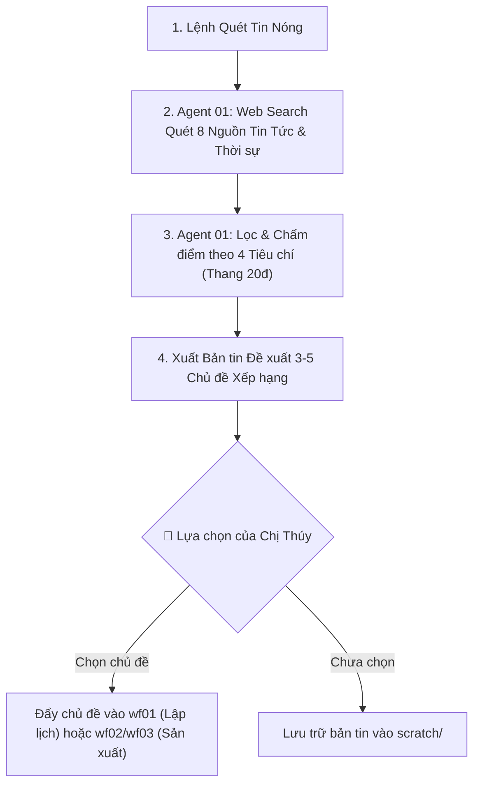

# WORKFLOW 05: QUÉT TIN NÓNG CHỦ ĐỘNG & ĐỀ XUẤT CHỦ ĐỀ (HOT NEWS SCANNER)

*Mã quy trình:* `wf05`  
*Mục tiêu:* Chủ động quét các cổng thông tin, báo chí và diễn đàn lớn (8 nguồn chính thống) để tìm kiếm các cơ hội nội dung nóng nhất trong tuần, đánh giá theo thang điểm 4 tiêu chí và xuất bản tin đề xuất cho chị Thúy lựa chọn.  
*Tác tử tham gia:* **Agent 01 (Market Researcher - Chế độ Hot News Scanner)**.

---

## 🧭 1. Điều kiện Kích hoạt & Đầu vào (Trigger & Inputs)

- **Câu lệnh kích hoạt mẫu:** *"Quét tin nóng tuần này", "Đề xuất 5 chủ đề nóng cho tuần tới", "Tuần này ngành XNK có gì hot?"*
- **Dữ liệu đầu vào:**
  1. 8 Nguồn quét chính thống: customs.gov.vn, chinhphu.vn, haiquanonline.com.vn, congthuong.vn, tapchitaichinh.vn, Google Trends VN, World Shipping Council / Drewry, và `scratch/daily_notes.md`.
  2. [`reports/SEO_Keyword_Trends_Eureka.xlsx`](file:///d:/AI%20AGENT%20THUY/AI%20branding/reports/SEO_Keyword_Trends_Eureka.xlsx) (Sheet 3 - 16 tin nóng).

---

## 🔄 2. Các Bước Phối Hợp Chi Tiết (Step-by-Step Execution)

### Bước 1: Quét nguồn tin tức (Agent 01)
- Thực hiện Web Search tìm kiếm các sự kiện phát sinh trong vòng 7-30 ngày gần nhất liên quan đến: biến động cước vận tải biển, cửa khẩu Trung - Việt, quy định CBAM, kiểm tra chuyên ngành, các sai phạm hải quan phổ biến.

### Bước 2: Đánh giá & Chấm điểm Cơ hội (Agent 01)
Mỗi sự kiện được đánh giá theo 4 tiêu chí (thang điểm 1-5, tối đa 20 điểm):
1. **Tính thời sự (Timeliness):** Đang nóng / sắp có hiệu lực?
2. **Độ đau (Pain Level):** Ảnh hưởng trực tiếp đến túi tiền/rủi ro của doanh nghiệp?
3. **Tiềm năng tranh luận (Debate Potential):** Có 2 luồng quan điểm trái chiều để thảo luận trên Facebook không?
4. **Khả năng cho giá trị sâu (Value Depth):** Có đủ dữ liệu kỹ thuật để làm video hướng dẫn trên YouTube không?

### Bước 3: Xuất Bản tin Đề xuất & Trình chị Thúy
- Báo cáo 3-5 chủ đề đạt điểm cao nhất theo mẫu:
  - Tên chủ đề + Tuyến Pillar (CS/TN/HT/FF)
  - Nền tảng khuyến nghị (Facebook / YouTube / Cả hai)
  - Điểm số 4 tiêu chí + Tóm tắt lý do nên làm
  - URL nguồn bài viết báo chí xác thực.
