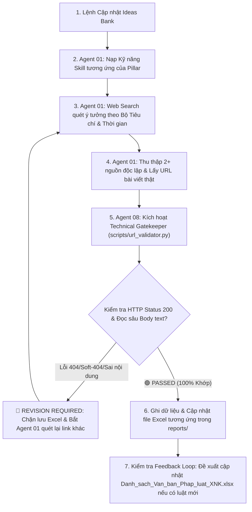

# WORKFLOW 06: CẬP NHẬT KHO Ý TƯỞNG 4 PILLARS (IDEAS BANK UPDATE)

*Mã quy trình:* `wf06`  
*Mục tiêu:* Quét và đóng gói định kỳ 5 ý tưởng mới cho mỗi Pillar (Case Study, Tin Ngành, Học Thực Chiến, Funfact) vào các file Excel tương ứng trong thư mục `reports/`, tuân thủ nghiêm ngặt quy tắc thời gian (2025-2026), đa nguồn đối soát (2+ nguồn, ưu tiên Thư Viện Pháp Luật) và **bắt buộc chạy qua Technical Gatekeeper (`scripts/url_validator.py`) để đọc và đối soát 100% nội dung thực tế trước khi lưu**.  
*Tác tử tham gia:* **Agent 01 (Market Researcher - Thu thập & Đóng gói)**, **Agent 08 (Fact Checker - Thẩm định Kỹ thuật Sâu URL & SSoT)**.

---

## 🧭 1. Điều kiện Kích hoạt & Đầu vào (Trigger & Inputs)

- **Câu lệnh kích hoạt mẫu:** *"Cập nhật kho ý tưởng", "Quét 5 ý tưởng mới cho Pillar Tin Ngành", "Làm dày Ideas Bank"*
- **Dữ liệu đầu vào & Kỹ năng bắt buộc:**
  1. [`skills/pillar-cs-casestudy/SKILL.md`](file:///d:/AI%20AGENT%20THUY/AI%20branding/skills/pillar-cs-casestudy/SKILL.md)
  2. [`skills/pillar-tn-news/SKILL.md`](file:///d:/AI%20AGENT%20THUY/AI%20branding/skills/pillar-tn-news/SKILL.md)
  3. [`skills/pillar-ht-tutorial/SKILL.md`](file:///d:/AI%20AGENT%20THUY/AI%20branding/skills/pillar-ht-tutorial/SKILL.md)
  4. [`skills/pillar-ff-funfact/SKILL.md`](file:///d:/AI%20AGENT%20THUY/AI%20branding/skills/pillar-ff-funfact/SKILL.md)
  5. [`skills/ssot-research/SKILL.md`](file:///d:/AI%20AGENT%20THUY/AI%20branding/skills/ssot-research/SKILL.md)
  6. [`skills/compliance-fact-check/SKILL.md`](file:///d:/AI%20AGENT%20THUY/AI%20branding/skills/compliance-fact-check/SKILL.md)
  7. **Công cụ Rào chắn Kỹ thuật:** [`scripts/url_validator.py`](file:///d:/AI%20AGENT%20THUY/AI%20branding/scripts/url_validator.py)

---

## 🔄 2. Các Bước Phối Hợp Chi Tiết (Step-by-Step Execution)

### Quy tắc Vàng khi Cập nhật (Bắt buộc tuân thủ):
1. **Quy tắc Thời gian (Mốc thời gian 15/08/2026):**
   - **Tin Ngành (TN):** Dưới 1 tháng tuổi (15/07/2026 - 15/08/2026).
   - **Học Thực Chiến (HT):** Dưới 2 tháng tuổi (15/06/2026 - 15/08/2026).
   - **Case Study (CS):** Trong vòng 1 đến 2 năm (08/2024 - 08/2026).
   - **Funfact (FF):** Lịch sử/Quốc tế có liên hệ kinh doanh hiện đại.
2. **Quy tắc Nguồn & Rào chắn Kỹ thuật URL:**
   - Bắt buộc đối chiếu từ 2 nguồn trở lên.
   - Đối với nội dung nghiệp vụ pháp lý, bắt buộc tham khảo **thuvienphapluat.vn** hoặc Cổng TTĐT Chính phủ / Tổng cục Hải quan.
   - **BẮT BUỘC:** 100% URL phải được chạy kiểm thử qua `scripts/url_validator.py`, gửi HTTP GET thật và đọc nội dung văn bản trong trang để chứng minh trang web thực sự nói về chủ đề đó.
   - Tuyệt đối cấm sử dụng link giả định, link chuyển hướng Soft-404 hoặc link trang chủ chung chung.

### Các tệp Excel được cập nhật:
- [`reports/Tin_Nganh_Ideas_Bank_Eureka.xlsx`](file:///d:/AI%20AGENT%20THUY/AI%20branding/reports/Tin_Nganh_Ideas_Bank_Eureka.xlsx)
- [`reports/Case_Study_Ideas_Bank_Eureka.xlsx`](file:///d:/AI%20AGENT%20THUY/AI%20branding/reports/Case_Study_Ideas_Bank_Eureka.xlsx)
- [`reports/Hoc_Thuc_Chien_Ideas_Bank_Eureka.xlsx`](file:///d:/AI%20AGENT%20THUY/AI%20branding/reports/Hoc_Thuc_Chien_Ideas_Bank_Eureka.xlsx)
- [`reports/Funfact_Ideas_Bank_Eureka.xlsx`](file:///d:/AI%20AGENT%20THUY/AI%20branding/reports/Funfact_Ideas_Bank_Eureka.xlsx)
