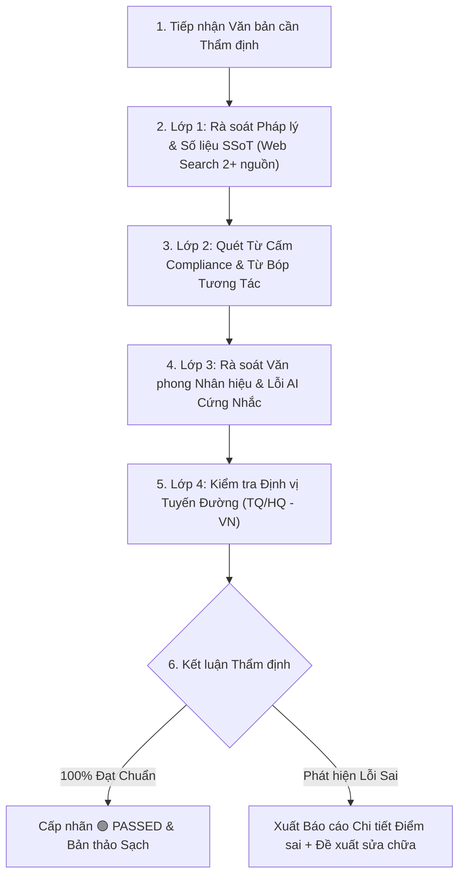

# WORKFLOW 07: RÀ SOÁT & THẨM ĐỊNH TÍNH CHÍNH XÁC NỘI DUNG (CONTENT AUDIT & VERIFICATION)

*Mã quy trình:* `wf07`  
*Mục tiêu:* Tiếp nhận một bài viết, kịch bản, slide, hoặc đoạn văn bản bất kỳ (do chị Thúy tự viết, copy từ ngoài vào, hoặc bài viết cũ) để rà soát toàn diện: tính chính xác của số hiệu luật/số liệu (SSoT), quét sạch từ cấm/từ bóp tương tác, phát hiện lỗi giọng văn AI cứng nhắc/tính từ kịch tính thái quá, và cấp chứng nhận kiểm định `🟢 PASSED` hoặc chỉ rõ từng lỗi cần sửa.  
*Tác tử tham gia:* **Agent 08 (Fact Checker - Chủ trì)**, **Agent 02 (SEO & Policy Consultant - Hỗ trợ)**.

---

## 🧭 1. Điều kiện Kích hoạt & Đầu vào (Trigger & Inputs)

- **Câu lệnh kích hoạt mẫu:** 
  - *"Rà soát bài viết này giúp tôi"*
  - *"Kiểm tra tính chính xác và hợp lệ của nội dung sau trước khi đăng"*
  - *"Thẩm định kịch bản này có dính từ cấm hoặc sai luật không"*
- **Dữ liệu đầu vào:**
  1. Toàn văn bài viết, kịch bản hoặc đường dẫn file `.md` cần rà soát.
  2. Nền tảng dự kiến đăng (Facebook, YouTube, LinkedIn, TikTok).
  3. [`knowledge/banned_words.md`](file:///d:/AI%20AGENT%20THUY/AI%20branding/knowledge/banned_words.md) — Danh mục từ cấm compliance.
  4. [`knowledge/voice_samples.md`](file:///d:/AI%20AGENT%20THUY/AI%20branding/knowledge/voice_samples.md) — Mẫu giọng văn thực tế của chị Thúy.
  5. Kỹ năng thẩm định [`skills/compliance-fact-check/SKILL.md`](file:///d:/AI%20AGENT%20THUY/AI%20branding/skills/compliance-fact-check/SKILL.md).

---

## 🔄 2. Quy trình Thẩm định 4 Lớp Chặt chẽ (4-Layer Audit Protocol)



### Lớp 1: Thẩm định Tính Chính xác Pháp lý & Số liệu (SSoT Zero-Trust)
- Liệt kê toàn bộ các tuyên bố sự thật (số hiệu Nghị định, Thông tư, ngày hiệu lực, mã HS, thuế suất, số liệu thống kê).
- Chạy Web Search tra cứu trực tiếp trên **thuvienphapluat.vn**, **customs.gov.vn**, **chinhphu.vn** từ 2 nguồn độc lập.
- Phát hiện và cảnh báo nếu có điều luật đã hết hiệu lực hoặc bị trích dẫn sai ngữ cảnh.

### Lớp 2: Rà soát Từ Cấm & Thuật toán Nền tảng (Platform Compliance)
- Quét toàn bộ từ ngữ trong danh sách cấm tại `banned_words.md` (đặc biệt là các từ liên quan đến tiểu ngạch, trốn thuế, lách luật).
- Đối chiếu với danh sách "Từ cấm động" của nền tảng để tránh bị bóp reach/shadowban.

### Lớp 3: Rà soát Văn phong Nhân hiệu & Lọc Bỏ Giọng AI (Persona & Tone)
- Quét và loại bỏ triệt để:
  - Các cụm từ AI sáo rỗng: *"đột phá"*, *"vượt bậc"*, *"hệ sinh thái"*, *"chìa khóa vàng"*...
  - Các từ trịnh trọng cứng nhắc: *"nhiều bác nghĩ"*, *"than thở"*, *"hoan nghênh"*, *"doanh nghiệp bạn xoay xở thế nào"*...
  - Các tính từ/trạng từ cảm xúc kịch tính thái quá: *"đau đớn"*, *"giật mình"*, *"hoảng loạn"*, *"sợ hãi kịch tính"*, *"chao đảo"*, *"kinh hoàng"*.
- Đảm bảo tỷ lệ hài hòa: **60% Giáp Mộc** (vững chãi, bao bọc, hướng dẫn giải pháp) và **40% Liêm Trinh** (chính trực, cảnh báo rủi ro thực tế).

### Lớp 4: Kiểm tra Định vị Tuyến Thương Mại (Trade Corridor Rule)
- Đảm bảo các ví dụ trải nghiệm thực tế chỉ nằm trên tuyến **Trung Quốc - Việt Nam** và **Hàn Quốc - Việt Nam**.
- Các thông tin về Âu Mỹ / Quốc tế chỉ được trích dẫn dưới dạng thông tin thị trường khách quan (không đóng vai trực tiếp).

---

## 📋 3. Cấu trúc Báo cáo Thẩm định Trả về cho Chị Thúy

```markdown
# 🛡️ BÁO CÁO THẨM ĐỊNH & RÀ SOÁT TÍNH CHÍNH XÁC NỘI DUNG

- **Tác tử thẩm định:** Agent 08 (Fact Checker) & Agent 02 (SEO/Compliance)
- **Nền tảng kiểm tra:** [Facebook / YouTube / LinkedIn]
- **KẾT QUẢ CUỐI CÙNG:** [🟢 PASSED / 🔴 REVISION REQUIRED]

---

### 1. Bảng Đối Soát Pháp lý & Số liệu Thực tế (SSoT Verification)
| Tuyên bố / Số liệu trong bài | Nguồn tra cứu xác thực (URL) | Trạng thái |
|---|---|---|
| [Ví dụ: Nghị định 36/2026/NĐ-CP] | thuvienphapluat.vn/van-ban/... | ✅ Khớp 100% |
| [Ví dụ: Thuế suất NK 5%] | customs.gov.vn/... | ❌ Sai (Thực tế là 0%) |

### 2. Danh sách Từ Cấm & Từ Cần Thay Thế (Compliance Audit)
- ❌ Từ phát hiện: `[từ vi phạm]` $\rightarrow$ 🟢 Đề xuất thay thế: `[từ chuẩn]`

### 3. Đánh giá Văn phong & Định vị Nhân hiệu
- Tỷ lệ Giáp Mộc / Liêm Trinh: [Đạt chuẩn / Cần điều chỉnh]
- Phát hiện từ AI / Cảm xúc quá đà: [Không có / Đã bôi đỏ các từ ...]

### 4. Bản thảo Đã Được Chỉnh Sửa Chuẩn Hóa (Clean Version)
[Đoạn văn bản sau khi đã được Agent 08 sửa sạch toàn bộ lỗi, sẵn sàng copy để đăng]
```
