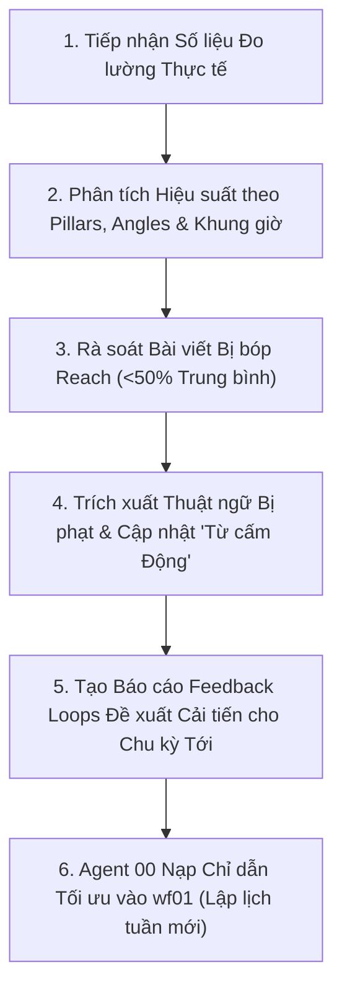

# WORKFLOW 08: ĐÁNH GIÁ HIỆU SUẤT & CẬP NHẬT TỪ CẤM ĐỘNG (PERFORMANCE REVIEW & FEEDBACK LOOPS)

*Mã quy trình:* `wf08`  
*Mục tiêu:* Tiếp nhận số liệu đo lường thực tế sau khi đăng bài (Views, Likes, Comments, Shares, Retention) để đánh giá hiệu quả của các Trụ cột (Pillars), Góc tiếp cận (Angles) và khung giờ đăng; phát hiện các bài viết bị bóp reach để cập nhật vào danh mục "Từ cấm động" (Dynamic Banned Words) và cung cấp chỉ dẫn tối ưu ngược lại cho chu kỳ tiếp theo.  
*Tác tử tham gia:* **Agent 07 (Performance Analyst - Chủ trì)**, **Agent 02 (SEO Consultant)**.

---

## 🧭 1. Điều kiện Kích hoạt & Đầu vào (Trigger & Inputs)

- **Câu lệnh kích hoạt mẫu:** 
  - *"Đánh giá hiệu quả các bài viết tuần qua"*
  - *"Bài viết này view thấp bất thường, kiểm tra xem có dính từ bóp tương tác không"*
  - *"Báo cáo tổng kết hiệu suất tháng"*
- **Dữ liệu đầu vào:**
  1. Bảng số liệu đo lường thực tế trên Facebook (Reach, Comments, Shares) và YouTube (Views, Retention, CTR, AVD).
  2. File cấu hình từ cấm [`knowledge/banned_words.md`](file:///d:/AI%20AGENT%20THUY/AI%20branding/knowledge/banned_words.md).
  3. File danh sách từ cấm động `banned_words_list.json` của Kỹ năng `seo-compliance`.

---

## 🔄 2. Các Bước Phối Hợp Chi Tiết (Step-by-Step Execution)

### Bước 1: Tiếp nhận & Đối chiếu KPI Benchmarks (Agent 07)
- Thu thập và so sánh lượng reach ban đầu ở 1 giờ đầu tiên theo từng khung giờ đăng.
- Đo lường chỉ số giữ chân (Average View Duration) của video YouTube theo từng định dạng (Học 5 phút vs Funfact 10 phút vs Case Study 15 phút).
- Đánh giá Pillar nào tạo ra thảo luận sâu nhất trên Facebook (comment depth).

### Bước 2: Phát hiện Thuật ngữ Bị Bóp Tương Tác & Cập nhật Từ Cấm Động
- Lọc ra các bài viết có tương tác dưới 50% mức trung bình.
- Phân tích từ ngữ trong bài viết đó để tìm ra các thuật ngữ nhạy cảm bị thuật toán quét.
- Cập nhật trực tiếp vào file danh sách từ cấm động để Agent 02 và Agent 08 tự động áp dụng cho các bài viết tiếp theo.

### Bước 3: Xuất Báo cáo Feedback Loops & Điều chỉnh Lịch Tuần Sau
- **Khung giờ vàng đề xuất:** Điều chỉnh giờ đăng cho Facebook (ví dụ: chuyển từ 18h sang 20h) và YouTube.
- **Định dạng ưu tiên:** Tăng tỷ trọng định dạng đang thắng lớn và giảm định dạng kém hiệu quả.
- **Chuyển giao:** Gửi bản tóm tắt khuyến nghị cho **Agent 00** để tự động nạp vào **Bước 0 của `wf01_weekly_planning.md`**.
