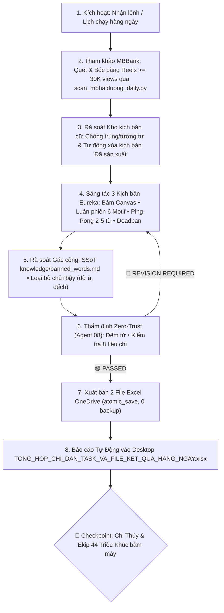

# WORKFLOW 09: SẢN XUẤT VIDEO NGẮN VIRAL REELS CHO FANPAGE EUREKA (EUREKA VIRAL REELS PRODUCTION)

*Mã quy trình:* `wf09`  
*Mục tiêu:* Tiếp nhận yêu cầu sáng tạo video ngắn (Facebook Reels, TikTok, Shorts), chủ động quét và tham khảo kịch bản mới triệu view từ kênh MBBank Hải Dương ($\ge 30$K views), đối chiếu chống trùng kịch bản cũ, tự động xóa kịch bản đã sản xuất khi đến lịch, biên soạn 3 kịch bản hài văn phòng mới mỗi ngày bám sát Canvas Eureka, luân phiên 6 Motif, thoại Ping-Pong 2-5 từ, rà soát 100% qua SSoT `knowledge/banned_words.md` và xuất bản đúng 2 file mục tiêu trên OneDrive.  
*Tác tử tham gia:* **Agent 09 (Viral Reels Director)**, **Agent 02 (Policy & SEO Consultant)**, **Agent 08 (Fact Checker & Compliance Auditor)**.

---

## 🧭 1. Điều kiện Tiên quyết & Dữ liệu Đầu vào

- **Câu lệnh kích hoạt mẫu:** *"/viral-reels", "/fb-video", "viết 3 kịch bản viral mới hôm nay", "lập kịch bản reels tham khảo MB", "chạy kịch bản hàng ngày"*
- **Dữ liệu đầu vào bắt buộc:**
  1. [`HUONG_DAN_LAP_KICH_BAN_HANG_NGAY.md`](file:///d:/AI%20AGENT%20THUY/AI%20branding/HUONG_DAN_LAP_KICH_BAN_HANG_NGAY.md) (Chỉ thị thực thi chi tiết hàng ngày của Agent).
  2. Kênh Facebook Reels MBBank Hải Dương được quét qua script [`scripts/scan_mbhaiduong_daily.py`](file:///d:/AI%20AGENT%20THUY/AI%20branding/scripts/scan_mbhaiduong_daily.py) (Ngưỡng lọc $\ge 30,000$ views, bóc băng audio 100%).
  3. [`agents/09_viral_reels_director.md`](file:///d:/AI%20AGENT%20THUY/AI%20branding/agents/09_viral_reels_director.md) (Quy chuẩn 6 hạng mục cốt lõi & 6 Motif).
  4. [`knowledge/banned_words.md`](file:///d:/AI%20AGENT%20THUY/AI%20branding/knowledge/banned_words.md) (Bộ từ cấm Master của hệ thống).
  5. Tài sản thương hiệu & Canvas Eureka (Pháp nhân 10 năm, >1.000 mặt hàng máy móc/thiết bị, gom cont LCL từ 1 khối, phòng XNK 5 triệu, công nợ 10-40%, 100% hóa đơn VAT).

---

## 🎯 2. Quy Định Phân Luồng 2 File Excel Đích (Tuyệt Đối Không Nhầm Lẫn)

Mỗi luồng dữ liệu bắt buộc ghi nhận vào đúng file tương ứng trên OneDrive:

| Luồng tác vụ | Tệp Excel đích trên OneDrive | Mục đích lưu trữ & Nội dung |
| :--- | :--- | :--- |
| **Luồng 1: Đào kịch bản MBBank** | `C:\Users\thuyn\OneDrive - EUREKA TRADE AND IMPORT EXPORT COMPANY LIMITED\BRANDING\video content\BANG_KICH_BAN_EUREKA_CHUAN_THOAI_MB.xlsx.tmp.xlsx` *(hoặc `.xlsx`)* | Lưu trữ 100% dữ liệu bóc băng lời thoại gốc từ audio MBBank ($\ge 30$K views) và bản đối ứng chuyển thể văn phòng Eureka (Cột 4 & Cột 5). |
| **Luồng 2: Tạo kịch bản mới Eureka** | `C:\Users\thuyn\OneDrive - EUREKA TRADE AND IMPORT EXPORT COMPANY LIMITED\BRANDING\video content\BANG_10_KICH_BAN_VIRAL_EUREKA_DA_DANG_6_MOTIF.xlsx` | Lưu trữ 3 kịch bản mới độc lập mỗi ngày (Sheet 1: `KICH_BAN_VIRAL_REELS`), quy tắc chuẩn hóa (Sheet 2), từ cấm (Sheet 3) và kho ý tưởng (Sheet 4). |

---

## 🔄 3. Các Bước Phối Hợp Chi Tiết (Step-by-Step Execution)

---

### Bước 1: Tham khảo Kịch bản mới từ MBBank Hải Dương ($\ge 30$K views)
- **Hành động của Agent 09:** Chạy script [`scripts/scan_mbhaiduong_daily.py`](file:///d:/AI%20AGENT%20THUY/AI%20branding/scripts/scan_mbhaiduong_daily.py) để quét các video Reels mới nhất trên Fanpage MBBank Hải Dương.
- **Bộ lọc:** Lọc chính xác các video đạt **$\ge 30,000$ views**, tải luồng audio sạch `.mp3` và chạy `faster-whisper` bóc băng 100% nguyên văn từng câu thoại.
- **Giải phẫu cấu trúc hài:** Bóc tách "ngòi nổ gây cười" (Comedy Trigger: tự tin thái quá, hiểu nhầm nghĩa đen, sợ vợ, trớ trêu con số, đụng độ Sếp - Nhân viên) để lấy cảm hứng chuyển hóa.
- **Lưu trữ đào kịch bản:** Ghi dữ liệu bóc băng vào `BANG_KICH_BAN_EUREKA_CHUAN_THOAI_MB.xlsx.tmp.xlsx` (hoặc `.xlsx`).

---

### Bước 2: Rà soát Kho kịch bản cũ (Chống trùng & Tự động dọn dẹp)
Trước khi viết kịch bản mới, Agent 09 bắt buộc mở file `BANG_10_KICH_BAN_VIRAL_EUREKA_DA_DANG_6_MOTIF.xlsx` và thực hiện 2 thao tác:
1. **Quy tắc Chống trùng lặp tuyệt đối:**
   - So sánh ý tưởng mới dự kiến với toàn bộ kịch bản đã có.
   - **Cấm trùng hoặc tương tự:** Không lặp lại cùng một tình huống drama, cùng ngòi nổ hay cú lật (Twist) của các kịch bản cũ. Phải mở rộng biên độ sang các khía cạnh nghiệp vụ mới (app ERP theo dõi cont kho Bằng Tường, phòng XNK 5 triệu, công nợ 40%, thủ tục C/O Form E 3 bên, giám định dây chuyền máy móc theo Quyết định 18...).
2. **Quy tắc Tự động xóa kịch bản "Đã sản xuất" khi đến lịch:**
   - Quét cột Trạng thái / Ghi chú sản xuất trong Sheet 1.
   - Nếu kịch bản nào được ghi chú **"Đã sản xuất"** (hoặc đã quay xong theo lịch bấm máy) $\rightarrow$ **Tự động xóa khỏi bảng kịch bản chờ quay**.
   - Bảng kịch bản luôn chỉ duy trì các kịch bản mới, sẵn sàng bấm máy, giữ file gọn gàng sạch sẽ.

---

### Bước 3: Soạn thảo 3 Kịch bản Mới Mỗi Ngày (Agent 09)
- **Sản lượng:** Đúng **3 kịch bản mới/ngày** (Đánh mã tiếp nối `EKA-V2-01`, `EKA-V2-02`... `EKA-V2-14`...).
- **Đúng 4 nhịp thời lượng 30s:** Hook (0-3s) -> Escalation (4-15s) -> Punchline (16-25s) -> Deflation (26-30s).
- **Thoại Ping-Pong dồn dập:** Mỗi câu ngắt đúng **2 đến 5 từ**, tiết tấu cực nhanh.
- **Phong thái Sếp Thúy:** Đẳng cấp Nữ CEO B2B, văn minh, đĩnh đạc, châm biếm sâu cay với nét mặt Deadpan đơ lạnh 1.5s.
- **Bối cảnh 100% văn phòng:** 44 Triều Khúc, sử dụng đạo cụ có sẵn (bút lò xo, thỏi son, tập kẹp file, máy in, con dấu).

---

### Bước 4: Rà soát Từ cấm qua SSoT `banned_words.md` (Agent 02 & Agent 09)
- Đối chiếu 100% nội dung với [`knowledge/banned_words.md`](file:///d:/AI%20AGENT%20THUY/AI%20branding/knowledge/banned_words.md).
- **Xóa sạch từ bất lịch sự/chửi bậy:** Cấm tiệt *"Dở à!"*, *"Đếch"*, *"Điên à"*, *"Mày - Tao"* xẵng giọng. Thay bằng phản xạ tưng tửng: *"Ơ hay!"*, *"Làm ăn thế đấy!"*, *"Chán các bác thế!"*, *"Ai lại thế bao giờ!"*, *"Chịu hai đứa luôn!"*.
- **Cấm thuật ngữ tiêu cực ngành:** Không trốn thuế, không buôn lậu, không bao thuế, không tiểu ngạch.
- **Cấm ví dụ đồ chơi:** 100% tập trung máy móc công nghiệp, dây chuyền cơ khí, thiết bị điện, linh kiện gia dụng, hàng mẫu hỏa tốc.

---

### Bước 5: Thẩm định Gác cổng (Agent 08 - Checkpoint Thẩm định)
- Đếm số từ từng câu thoại (đúng 2-5 từ).
- Kiểm tra tính văn minh, sắc bén chuẩn phong thái CEO B2B của Sếp Thúy.
- Kiểm tra tính mới mẻ (không tương tự kịch bản cũ).
- Xác nhận trạng thái `🟢 PASSED` trước khi ghi file.

---

### Bước 6: Đóng gói & Xuất bản ra 2 File Excel OneDrive (Agent 09)
- **Kịch bản mới Eureka:** Ghi vào Sheet 1 của `BANG_10_KICH_BAN_VIRAL_EUREKA_DA_DANG_6_MOTIF.xlsx`.
- **Dữ liệu đào MBBank:** Ghi vào `BANG_KICH_BAN_EUREKA_CHUAN_THOAI_MB.xlsx.tmp.xlsx` (hoặc `.xlsx`).
- **Nguyên tắc kỹ thuật:** Bắt buộc áp dụng cơ chế lưu nguyên tử `atomic_save` (ghi ra `.tmp.xlsx` rồi `os.replace`), **TUYỆT ĐỐI KHÔNG TẠO BẤT KỲ FILE BACKUP NÀO** theo RULE 10.

---

### Bước 7: Báo cáo Tự Động vào Desktop `TONG_HOP_CHI_DAN_TASK_VA_FILE_KET_QUA_HANG_NGAY.xlsx`
- Ngay sau khi lưu file Excel thành công, Agent 09 tự động kích hoạt script:
  `python "D:\AI AGENT THUY\QUAN_TRI_TASK_HANG_NGAY\generator_chi_dan.py"`
- Mục tiêu: Cập nhật lại ngày giờ thực tế và đẩy thông tin lên:
  1. `C:\Users\thuyn\Desktop\TONG_HOP_CHI_DAN_TASK_VA_FILE_KET_QUA_HANG_NGAY.xlsx` (Sheet 01, mục 12 & 13).
  2. `C:\Users\thuyn\Desktop\BANG_CHIDAN_TASK_VA_KETQUA_HANGNGAY.html` (Bảng điều hành Desktop Giám Đốc).
